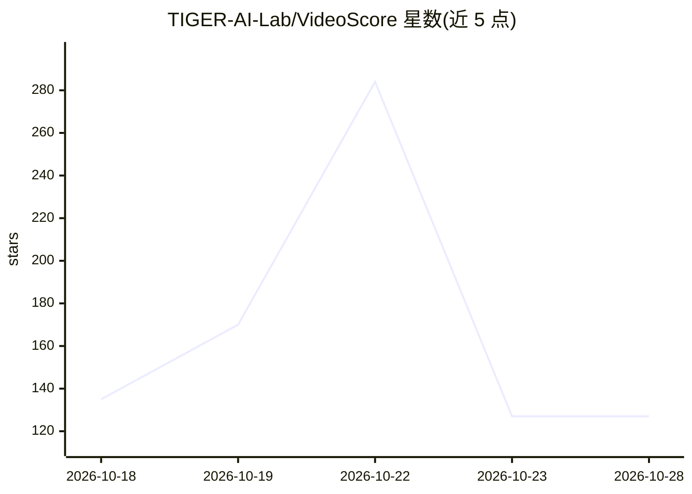

# TIGER-AI-Lab/VideoScore

⭐ 127 · Python · MIT · 推送 2025-12-04 · [GitHub](https://github.com/TIGER-AI-Lab/VideoScore) · [官网](https://tiger-ai-lab.github.io/VideoScore/) · 组织维护

**视频生成质量自动评测模型：模拟细粒度人类反馈打分**

EMNLP 2024 论文官方仓库，包含三部分产出：VideoFeedback 数据集（37.6K 合成视频、来自 11 个视频生成模型、5 个维度 1-4 分人类标注）；VideoScore 评测模型（以 Mantis-8B-Idefics2 为基座训练，对视频输出视觉质量、时序一致性、文视频对齐等细粒度分数）；VideoScore-Bench 测试集（约 7,000 视频）。作者定位其可用于给视频生成模型打分以追踪进展，并在 RLHF 中替代人类反馈。提供推理、评测、训练三套安装与脚本。

## 筛选速览

| 维度 | 判定 | 备注 |
|---|---|---|
| AI 角色 | `ai-ecosystem` | LLM/agent 周边工具 |
| 许可风险 | `permissive` | MIT |
| 部署形态 | `library` | 以包/库形式分发 |
| 模型依赖 | — | README 未给出锁定关系 |
| 硬件要求 | — | 无带数字的原话,不猜 |
| 安装摩擦 | `low` | 无编译、无系统依赖或容器化 |
| 成熟度 | — | 结构信号不足 |

## 能力要点

- 基于 37.6K 视频人类多维标注训练的视频质量评测模型
- 输出 5 个维度（视觉质量/时序一致性/动态程度/文视频对齐/事实一致性）的 1-4 分评分
- VideoFeedback 数据集与 VideoScore-Bench（约 7,000 视频）配套发布
- 支持推理、评测、训练三种安装路径

## 适用场景

- 为视频生成模型输出自动质量评分以追踪模型进展
- 在 RLHF 流程中模拟细粒度人类反馈
- 复现论文实验或基于 VideoFeedback 训练变体模型

## 场景标签

`模型评测` · 领域:评测与运维

## 证据(README 行号)

> L35: - 🏅**VideoScore**. We train VideoScore (initialized from Mantis) based on VideoFeedback to enable automatic video q
> L37: - 🫡**Human Feedback for Video generative models**. Due to these results, we believe VideoScore can serve as a great
> L70: - 🤗 VideoScore is a video quality evaluation model, taking Mantis-8B-Idefics2 as base-model and trained on VideoFee

## 星数曲线

2026-10-18 135 → 2026-10-28 127（-8）

---
*卡片 v1 · prompt 1.4 · 生成 2026-10-22 · 置信度 high · 依据 README sha `3a704cdfb5b1` · [字段定义](../../DATASET.md)*
