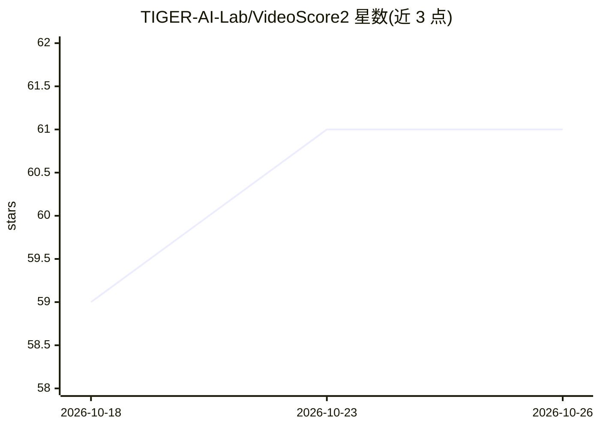

# TIGER-AI-Lab/VideoScore2

⭐ 61 · Python · MIT · 推送 2026-09-14 · [GitHub](https://github.com/TIGER-AI-Lab/VideoScore2) · [官网](https://tiger-ai-lab.github.io/VideoScore2/) · 组织维护

**生成视频的自动评测指标：多维度打分并给出推理依据**

论文配套官方仓库，提供视频生成质量的自动评测框架 VideoScore2：从视觉质量、文生视频对齐、物理/常识一致性三个维度打分，并输出 chain-of-thought 评分理由。模型基于 Qwen-VL 架构，在含 27,168 条人工标注视频（分数+推理轨迹）的 VideoFeedback2 数据集上经 SFT 与 GRPO 强化学习两阶段训练。另支持 11 个基线方法与 5 个基准的评测代码，训练流程见子目录 README。

## 筛选速览

| 维度 | 判定 | 备注 |
|---|---|---|
| AI 角色 | `ai-native` | 本体是模型或模型工具 |
| 许可风险 | `permissive` | MIT |
| 部署形态 | `library` | 以包/库形式分发 |
| 模型依赖 | — | README 未给出锁定关系 |
| 硬件要求 | — | 无带数字的原话,不猜 |
| 安装摩擦 | `low` | 无编译、无系统依赖或容器化 |
| 成熟度 | — | 结构信号不足 |

## 能力要点

- 三维度打分（视觉质量/文本对齐/物理与常识一致性）并输出可解释评分理由
- 基于 27,168 条人工标注视频的 VideoFeedback2 数据集训练（SFT+GRPO 两阶段）
- 支持 11 个基线方法与 5 个内外域基准的评测
- 可用于 Best-of-N 采样的奖励建模

## 适用场景

- 自动评估文生视频模型输出的质量与提示对齐度
- 作为奖励模型为视频生成做 Best-of-N 采样筛选
- 在标准基准上对比不同视频评测指标的表现

## 场景标签

`模型评测` · 领域:评测与运维

## 证据(README 行号)

> L33: Recent advances in text-to-video generation have produced increasingly realistic and diverse content, yet evaluatin
> L35: ## Inference

## 星数曲线

2026-10-18 59 → 2026-10-26 61（+2）

---
*卡片 v1 · prompt 1.4 · 生成 2026-10-24 · 置信度 high · 依据 README sha `b9ef00f621a2` · [字段定义](../../DATASET.md)*
