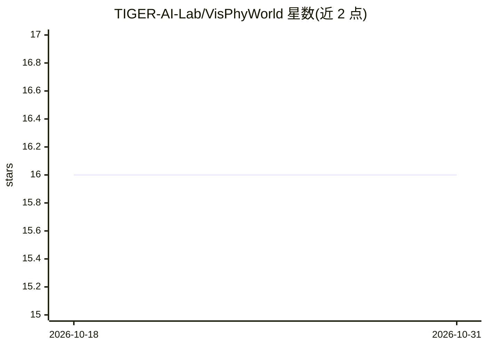

# TIGER-AI-Lab/VisPhyWorld

⭐ 16 · Python · MIT · 推送 2026-05-28 · [GitHub](https://github.com/TIGER-AI-Lab/VisPhyWorld) · [官网](https://tiger-ai-lab.github.io/VisPhyWorld/) · 组织维护

**评测 MLLM 物理推理的代码驱动视频重建框架与基准**

面向多模态大模型物理推理评测的执行式框架：给定视频观测，要求模型生成可执行的仿真代码，在固定物理引擎中重新仿真并预测未来运动，与真值对比衡量模型是否真正掌握动力学。配套 VisPhyBench 基准，含 209 个评测场景（源自 108 个物理模板）、2D 与 3D 场景、首帧检测 JSON 结构化标注及多族诊断指标。运行需 Python 3.10 conda 环境、FFmpeg、Node.js 18（Puppeteer 渲染管线）与 Hugging Face 数据集，提供单样本运行与批量评测 HTML 生成脚本。

## 筛选速览

| 维度 | 判定 | 备注 |
|---|---|---|
| AI 角色 | `ai-ecosystem` | LLM/agent 周边工具 |
| 许可风险 | `permissive` | MIT |
| 部署形态 | `library` | 以包/库形式分发 |
| 模型依赖 | — | README 未给出锁定关系 |
| 硬件要求 | — | 无带数字的原话,不猜 |
| 安装摩擦 | `medium` | 含编译或系统依赖之一 |
| 成熟度 | — | 结构信号不足 |

## 能力要点

- 模型输出可运行仿真代码，推理过程可检查、可编辑、可证伪
- VisPhyBench：209 个场景、108 个物理模板，含 2D/3D 场景
- 多族诊断指标（重建、运动、整体/LLM 评分等）
- 每样本附带首帧检测 JSON（物体、颜色、位置、bbox、尺寸）

## 适用场景

- 评测多模态大模型的物理推理与动力学预测能力
- 对比不同 LLM 在 2D/3D 物理场景下的重建表现
- 通过可执行仿真代码诊断模型物理参数推断的失败原因

## 场景标签

`模型评测` `多模态` · 领域:评测与运维

## 证据(README 行号)

> L11: VisPhyWorld evaluates physical reasoning by turning a model's prediction into an **executable hypothesis**: given v
> L24: Most existing benchmarks rely on recognition-style protocols such as Visual Question Answering (VQA) and Violation 

## 星数曲线

2026-10-18 16 → 2026-10-31 16（+0）

---
*卡片 v1 · prompt 1.4 · 生成 2026-10-30 · 置信度 mid · 依据 README sha `10bf1fee402b` · [字段定义](../../DATASET.md)*
