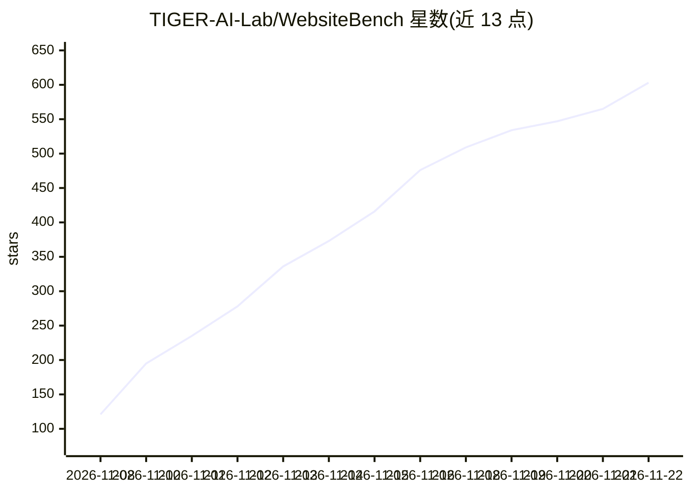

# TIGER-AI-Lab/WebsiteBench

⭐ 603 · Python · Apache-2.0 · 推送 2026-11-17 · [GitHub](https://github.com/TIGER-AI-Lab/WebsiteBench) · [官网](https://website-bench.com/) · 组织维护

**评测 AI agent 通过浏览器探索重建网站能力的基准**

WebsiteBench 是一个网站重建基准：给定可经浏览器探索的生产级网站，agent 需逆向工程出外观与行为尽量一致的全栈版本。共 70 个网站任务、46,916 个隐藏测试用例，托管于 Harbor Hub 与 Hugging Face。通过 pip 包下载任务，在 Docker 与 Harbor 框架上运行 agent；每个用例要求功能检查通过且视觉检查点达到归一化 SSIM 0.99，任务得分为通过用例占比。代码与任务定义以 Apache-2.0 发布，参考网站内容仅限非商业研究使用。

## 筛选速览

| 维度 | 判定 | 备注 |
|---|---|---|
| AI 角色 | `ai-ecosystem` | LLM/agent 周边工具 |
| 许可风险 | `permissive` | Apache-2.0 |
| 部署形态 | `library` | 以包/库形式分发 |
| 模型依赖 | — | README 未给出锁定关系 |
| 硬件要求 | — | 无带数字的原话,不猜 |
| 安装摩擦 | `low` | 无编译、无系统依赖或容器化 |
| 成熟度 | — | 结构信号不足 |

## 能力要点

- 70 个生产级网站任务与 46,916 个隐藏测试用例
- 评分结合功能检查与归一化 SSIM 0.99 视觉检查点
- 提供 pip 包下载任务与 Harbor 框架运行流程
- 含 oracle 参考解法与逐 trial 的 reward 输出

## 适用场景

- 评测 AI agent 的全栈网站逆向重建能力
- 在统一隐藏测试用例下对比不同 agent 与模型
- 通过排行榜追踪 agent 的网页重建进展

## 场景标签

`模型评测` · 领域:评测与运维

## 证据(README 行号)

> L3:  Can AI agents rebuild websites through browser exploration?
> L13: 70 websites and 46,916 hidden test cases, on Harbor Hub and Hugging Face. See the task list.
> L51: Each task has 302 to 2,016 hidden test cases. A case passes when its functional checks pass and every visual checkp

## 星数曲线

2026-11-08 121 → 2026-11-22 603（+482）

---
*卡片 v1 · prompt 1.4 · 生成 2026-11-17 · 置信度 high · 依据 README sha `d8828817d1d1` · [字段定义](../../DATASET.md)*
