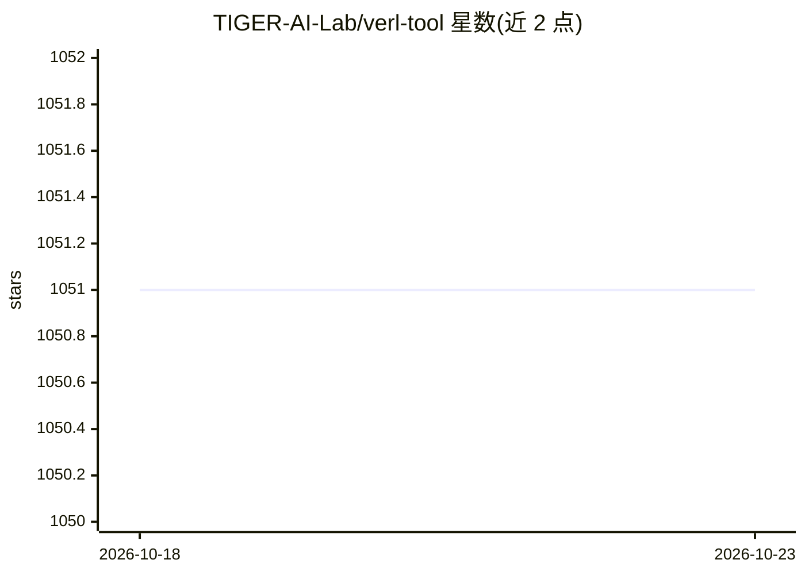

# TIGER-AI-Lab/verl-tool

⭐ 1,051 · Python · MIT · 推送 2026-07-15 · [GitHub](https://github.com/TIGER-AI-Lab/verl-tool) · [官网](https://arxiv.org/pdf/2509.01055) · 组织维护 · 中文 README

**基于 verl 的工具调用 agent 强化学习训练框架**

VerlTool 是基于 verl（作为子模块引入）的工具型 agent 强化学习训练与评测框架：将 actor rollout 与环境交互完全解耦，采用 tool-as-environment 范式存储/恢复环境状态，原生支持 agent 与工具环境的多轮交互循环，通过统一 API 新增工具只需添加一个 Python 文件。支持轨迹级异步 rollout，兼容 vllm（0.11.0）与 verl 0.6.0，已复现 Search-R1、支持 NL2SQL 工具 RL 与 DAPO 训练配方，并提供以 OpenAI API 形式启动模型加工具服务器的评测套件。论文获 TMLR 2026 接收。面向做工具调用 agent RL 训练的研究者与开发者。

## 筛选速览

| 维度 | 判定 | 备注 |
|---|---|---|
| AI 角色 | `ai-ecosystem` | LLM/agent 周边工具 |
| 许可风险 | `permissive` | MIT |
| 部署形态 | `None` |  |
| 模型依赖 | local-ok | 支持本地模型 |
| 硬件要求 | — | 无带数字的原话,不猜 |
| 安装摩擦 | `low` | 无编译、无系统依赖或容器化 |
| 成熟度 | — | 结构信号不足 |

## 能力要点

- actor rollout 与环境交互完全解耦，统一 API 添加新工具
- tool-as-environment 范式，按轨迹存储与恢复环境状态
- 轨迹级异步 rollout 加速带工具调用的生成
- OpenAI API 形式启动训练模型与工具服务器的评测套件

## 适用场景

- 训练带工具调用的多轮交互 agent 模型
- 复现或扩展 Search-R1、NL2SQL、DAPO 等训练配方
- 以 API 方式评测训练后模型的工具调用表现

## 场景标签

`强化学习` `模型评测` · 领域:评测与运维

## 证据(README 行号)

> L5: VerlTool: A unified and easy-to-extend tool-agent training framework based on verl.
> L32: - 🔧 **Complete decoupling of actor rollout and environment interaction** - We use verl as a submodule to benefit fr
> L34: - ⚡ **Native RL framework for tool-calling agents** - verl-tool natively supports multi-turn interactive loops betw

## 星数曲线

2026-10-18 1,051 → 2026-10-23 1,051（+0）

---
*卡片 v1 · prompt 1.4 · 生成 2026-10-21 · 置信度 high · 依据 README sha `cc49296d046b` · [字段定义](../../DATASET.md)*
