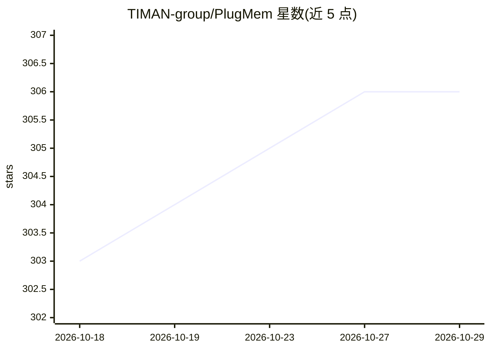

# TIMAN-group/PlugMem

⭐ 306 · Python · Apache-2.0 · 推送 2026-07-09 · [GitHub](https://github.com/TIMAN-group/PlugMem) · 组织维护

**LLM agent 的即插即用长期记忆模块**

面向 LLM agent 的长期记忆系统：将交互经验组织为语义、程序、情景三类可复用知识单元并以层级图结构维护，供 agent 决策时检索，降低上下文开销。任务无关设计，6 行代码接入现有管线；提供 OpenClaw 插件与 Claude Code 适配器，含可视化记忆图的 Memory Inspector Web UI。论文被 ICML 2026 接收，实验依赖 OpenAI API、本地 Qwen（vLLM）与 NV-Embed-v2 推理服务，安装需手动搭建 src/ 下各 benchmark 环境。

## 筛选速览

| 维度 | 判定 | 备注 |
|---|---|---|
| AI 角色 | `ai-ecosystem` | LLM/agent 周边工具 |
| 许可风险 | `permissive` | Apache-2.0 |
| 部署形态 | `None` |  |
| 模型依赖 | local-ok | 支持本地模型 |
| 硬件要求 | — | 无带数字的原话,不猜 |
| 安装摩擦 | `low` | 无编译、无系统依赖或容器化 |
| 成熟度 | — | 结构信号不足 |

## 能力要点

- 语义/程序/情景三类记忆单元的层级图结构
- 6 行代码接入现有 agent 管线，任务无关设计
- OpenClaw 插件暴露 plugmem.remember/recall 工具，自动保存并结构化会话轨迹
- Memory Inspector Web UI 支持浏览记忆、调试检索评分与回放会话

## 适用场景

- 为对话 agent 或知识密集型 QA 提供跨会话长期记忆
- 给 Claude Code 等 coding agent 挂载自积累项目约定的记忆层
- 复现 LongMemEval / HotpotQA / WebArena 记忆实验

## 场景标签

`Agent 记忆` · 领域:Agent 开发

## 证据(README 行号)

> L5: **PlugMem** is a **plug-and-play long-term memory system for LLM agents**. Instead of storing and retrieving raw int
> L7: The module is **task-agnostic by design** and can be integrated into existing agent pipelines with minimal effort, s
> L137: In addition to being a research project, we also ship PlugMem as a

## 星数曲线

2026-10-18 303 → 2026-10-29 306（+3）

---
*卡片 v1 · prompt 1.4 · 生成 2026-10-21 · 置信度 high · 依据 README sha `bc334eaee4c3` · [字段定义](../../DATASET.md)*
