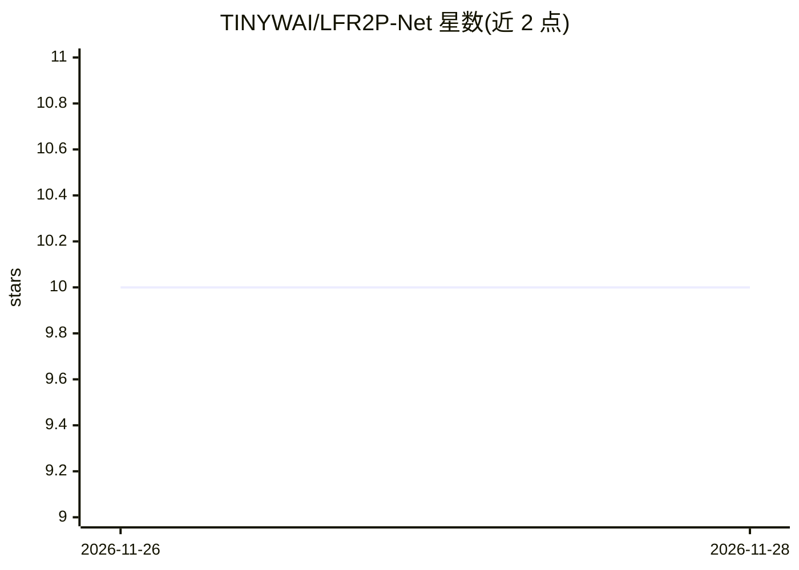

# TINYWAI/LFR2P-Net

⭐ 10 · Python · MIT · 推送 2026-10-27 · [GitHub](https://github.com/TINYWAI/LFR2P-Net) · 组织维护 · 中文 README

**灾害遥感科研网络：光学+SAR 多模态建筑损毁评估**

论文配套代码库，实现 LFR2P-Net：在事件前光学影像与事件后 SAR 影像上做多模态建筑损毁评估的语义分割网络。核心机制包括低频率引导的模态无关信息比较块（MAIC）与区域到像素精炼方法（R2PR），在 Bright 数据集上以 VMamba-Tiny 为骨干训练，输出逐类 IoU、mIoU 及按灾害事件/类型的评估指标。提供训练、评估脚本与 Google Drive 上的预训练/训练权重，需要自行编译 selective_scan 内核。

## 筛选速览

| 维度 | 判定 | 备注 |
|---|---|---|
| AI 角色 | `ai-native` | 本体是模型或模型工具 |
| 许可风险 | `permissive` | MIT |
| 部署形态 | `library` | 以包/库形式分发 |
| 模型依赖 | — | README 未给出锁定关系 |
| 硬件要求 | — | 无带数字的原话,不猜 |
| 安装摩擦 | `low` | 无编译、无系统依赖或容器化 |
| 成熟度 | — | 结构信号不足 |

## 能力要点

- MAIC 解码器与 R2PR 精炼方法的论文实现
- 基于 VMamba 骨干，在 Bright 数据集训练与评估
- 提供预训练权重与训练好的 checkpoint（Google Drive）
- 评估输出逐类 IoU、mIoU、按灾害事件/类型指标，可保存预测与可视化

## 适用场景

- 在 Bright 数据集上复现论文的训练与评估结果
- 对灾害前后光学/SAR 影像做建筑损毁分割研究
- 借鉴跨模态特征比较与区域先验精炼的分割方法

## 场景标签

`科研工具` `多模态` `目标检测` `模型训练` · 领域:学习与行业

## 证据(README 行号)

> L18: Combining the MAIC decoder and R2PR method, a low-frequency guided region-to-pixel refinement network (LFR2P-Net) i
> L71: python3 engine/train_val.py --config cfgs/bright_bs8_lfr2p-net_vmt.yaml
> L86: python3 engine/test.py --config cfgs/bright_bs8_lfr2p-net_vmt.yaml --ckpt path/to/checkpoint.pth.tar

## 星数曲线

2026-11-26 10 → 2026-11-28 10（+0）

---
*卡片 v1 · prompt 1.4 · 生成 2026-11-26 · 置信度 high · 依据 README sha `f4e51f06fee3` · [字段定义](../../DATASET.md)*
