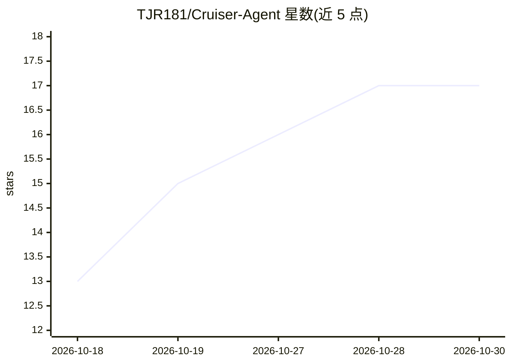

# TJR181/Cruiser-Agent

⭐ 17 · Python · Apache-2.0 · 推送 2026-08-30 · [GitHub](https://github.com/TJR181/Cruiser-Agent) · 个人维护 · 中文 README

**面向 CTF 评测平台的自动化漏洞挖掘与解题 Agent**

面向 TSec Benchmark 跑分平台的自动化 Web/逻辑漏洞挖掘与利用 Agent，自动完成拉题、启动靶场容器、驱动 Agent 解题、提交 flag、关闭容器的闭环。解题引擎基于 claude CLI 流式模式驱动自主 Agent，Anthropic 兼容端点默认接入 DeepSeek，支持按模型名路由 Kimi/GLM 等多厂商。采用三层进程架构（调度层/执行层/Agent 层），跨进程经文件系统共享黑板与任务板，四队列分层调度并多会话并发。运行需 Python 3.11、uv、claude CLI 与靶场 VPN，附运行台监控面板。

## 筛选速览

| 维度 | 判定 | 备注 |
|---|---|---|
| AI 角色 | `ai-native` | 本体是模型或模型工具 |
| 许可风险 | `permissive` | Apache-2.0 |
| 部署形态 | `None` |  |
| 模型依赖 | locked-api |  |
| 硬件要求 | — | 无带数字的原话,不猜 |
| 安装摩擦 | `low` | 无编译、无系统依赖或容器化 |
| 成熟度 | — | 结构信号不足 |

## 能力要点

- 调度层/worker/claude CLI 三层进程架构，崩溃可恢复
- 文件锁 + 原子重写的跨会话共享黑板与探索任务板
- 四队列分层调度（50/100/150/200 步阈值）与多会话并发
- 内置渗透/逆向/Pwn/密码取证/智能合约工具链与离线 PoC 知识库

## 适用场景

- 在 TSec Benchmark 平台自动批量解 CTF 题目并提交 flag
- 对指定靶机目标并发执行多会话黑盒漏洞扫描与利用
- 混搭多厂商模型（DeepSeek/Kimi/GLM）作为 worker 并发解题

## 场景标签

`网络安全` · 领域:学习与行业

## 证据(README 行号)

> L3: Cruiser 是一个面向 CTF 竞赛评测平台（TSec Benchmark）的自动化 Web/逻辑漏洞挖掘与利用 Agent。它对接跑分平台，自动完成「拉取题目 → 启动靶场容器 → 驱动 Agent 解题 → 提交 flag 
> L7: Cruiser 的解题引擎基于 `claude` CLI（`--output-format stream-json` 流式模式）驱动一个自主 Agent，Anthropic 兼容端点默认接入 DeepSeek。系统分为三层进程，边界
> L11: 3. **Agent 层（`claude` CLI 进程）** — 真正的解题智能体，使用其内置的 Bash/Read/Write 等工具执行侦察与利用。

## 星数曲线

2026-10-18 13 → 2026-10-30 17（+4）

---
*卡片 v1 · prompt 1.4 · 生成 2026-10-29 · 置信度 high · 依据 README sha `fb41496829ed` · [字段定义](../../DATASET.md)*
