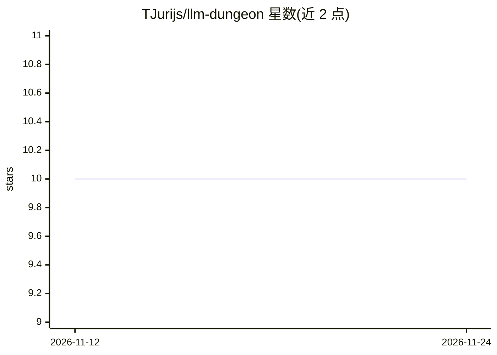

# TJurijs/llm-dungeon

⭐ 10 · JavaScript · Apache-2.0 · 推送 2026-09-07 · [GitHub](https://github.com/TJurijs/llm-dungeon) · 个人维护

**本地单人文字冒险 RPG：LLM 担任 DM，真实 d100 掷骰**

本地运行的单人文字冒险 RPG，LLM 扮演 DM 生成叙事并维持持久的世界记录。机制包括真实 d100 掷骰与难度/修正值计算、可创建和编辑冒险模板（英/俄双语）、DM 隐藏秘密的只读查看器、消费限额账本与按请求的成本记账、以及独立的模型审查步骤核对叙事与状态一致性。需 Node.js 22.13+，无需安装依赖包，配置 .env 中的提供商密钥即可运行。

## 筛选速览

| 维度 | 判定 | 备注 |
|---|---|---|
| AI 角色 | `ai-native` | 本体是模型或模型工具 |
| 许可风险 | `permissive` | Apache-2.0 |
| 部署形态 | `None` |  |
| 模型依赖 | — | README 未给出锁定关系 |
| 硬件要求 | — | 无带数字的原话,不猜 |
| 安装摩擦 | `low` | 无编译、无系统依赖或容器化 |
| 成熟度 | — | 结构信号不足 |

## 能力要点

- LLM 担任 DM，配合真实 d100 掷骰与显示的难度、修正值与成功概率
- 独立的模型审查流程：核对叙事、物品位置、事件时间与玩家意图
- 持久化世界记录（SQLite）与支出账本（JSON），密钥不下发到浏览器
- 支持冒险模板创建/复制，含不外泄的隐藏指令

## 适用场景

- 本地单人跑文字冒险/RPG 战役，DM 由模型扮演
- 英/俄双语切换游玩互动小说
- 希望控制并审计模型调用的花费

## 场景标签

`AI 助手` · 领域:对话与助手

## 证据(README 行号)

> L3: A local, single-player RPG with an inventive DM, persistent world records, real d100 rolls, and English/Russian play
> L35: - Describe what your character intends to do. The DM invents details within the setting and established history.

## 星数曲线

2026-11-12 10 → 2026-11-24 10（+0）

---
*卡片 v1 · prompt 1.4 · 生成 2026-11-20 · 置信度 high · 依据 README sha `f2086eb7acae` · [字段定义](../../DATASET.md)*
