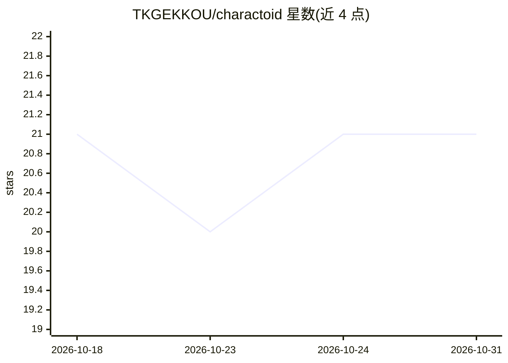

# TKGEKKOU/charactoid

⭐ 21 · Python · MIT · 推送 2026-09-14 · [GitHub](https://github.com/TKGEKKOU/charactoid) · [官网](https://tkgekkou.github.io/charactoid/) · 个人维护 · 中文 README

**本地优先的角色 Agent 工作台：对话中管理资源、语音与知识任务**

面向本地单用户与 Windows 桌面场景的角色化 Agent 运行平台：Core Agent 理解意图，Supervisor 编排，领域 Worker（知识/文档/语音/RVC/资源等）执行具体业务，Runtime 管理 Run/Job、事件与 Resume/Cancel。用户在对话中提出"安装模型""启动 GPT-SoVITS""把 PDF 加入知识库"等请求，系统按真实状态执行并返回可继续操作的任务卡片。默认使用本地文件、SQLite 与 Milvus Lite，不要求 Docker；首次使用需配置 LLM Provider，Embedding/FFmpeg 等按需准备。通过 git clone 与脚本启动。

## 筛选速览

| 维度 | 判定 | 备注 |
|---|---|---|
| AI 角色 | `ai-native` | 本体是模型或模型工具 |
| 许可风险 | `permissive` | MIT |
| 部署形态 | `desktop` | 安装包/桌面程序 |
| 模型依赖 | — | README 未给出锁定关系 |
| 硬件要求 | — | 无带数字的原话,不猜 |
| 安装摩擦 | `medium` | 含编译或系统依赖之一 |
| 成熟度 | — | 结构信号不足 |

## 能力要点

- 对话即控制台：自然语言触发资源安装、服务启动与长任务执行
- Supervisor + 领域 Worker 编排，任务区分未安装/运行中/失败/可恢复等真实状态
- 集成 GPT-SoVITS（TTS/ASR/音色训练）、RVC 变声、RAG（Milvus Lite 检索）
- Agent 合同拒绝 path/command/shell 等执行字段，高风险操作进入人工确认

## 适用场景

- 与自定义角色对话并让 Agent 代为完成资源准备和语音任务
- 用 RVC/GPT-SoVITS 在对话中完成变声、语音合成与音色训练
- 为角色构建含文档导入、检索与重排的本地知识库

## 场景标签

`语音合成` `语音识别` `知识库管理` · 领域:内容生成

## 证据(README 行号)

> L12: CHARACTOID 是一个**本地优先的角色 Agent 工作台**。它把角色对话、工具调用、知识检索、语音能力和长任务执行组织在同一条可恢复的 Agent 链路中。
> L14: 与“聊天页 + 一组互相独立的设置页”不同，CHARACTOID 的对话不仅用于回答问题，也可以作为实际操作入口：用户可以直接提出“检查资源”“安装模型”“启动 GPT-SoVITS”“把资料加入知识库”或“用这段音频做 RVC 
> L80: |角色 Agent 对话|角色资料、记忆、知识和能力策略共同参与对话，支持流式输出、中断和停止。|

## 星数曲线

2026-10-18 21 → 2026-10-31 21（+0）

---
*卡片 v1 · prompt 1.4 · 生成 2026-10-28 · 置信度 high · 依据 README sha `b516730ba658` · [字段定义](../../DATASET.md)*
