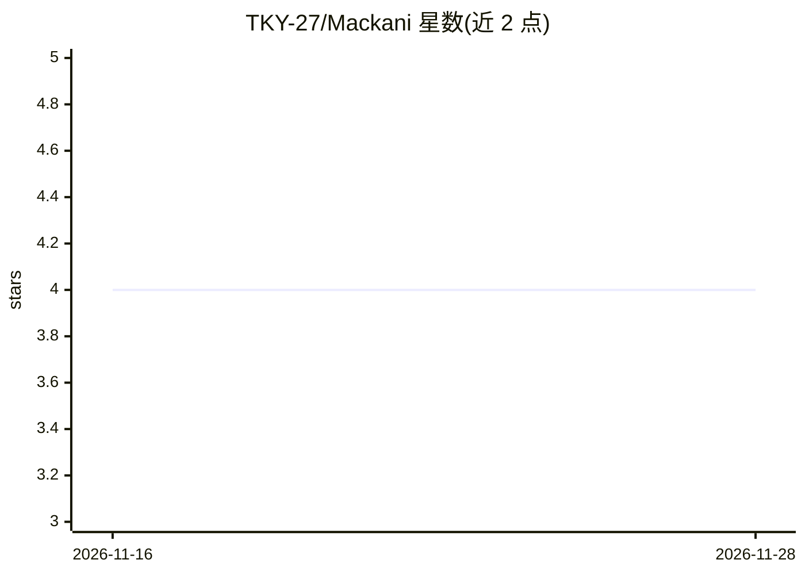

# TKY-27/Mackani

⭐ 4 · Rust · Apache-2.0 · 推送 2026-11-22 · [GitHub](https://github.com/TKY-27/Mackani) · [官网](https://github.com/TKY-27/Mackani/releases/latest) · 个人维护

**macOS 本地 LLM 推理引擎：运行 YASAKANI 模型并附带聊天应用**

YASAKANI 的非官方 Apple Silicon 移植，用 Rust 从零实现，通过 Metal、NEON 与线程池执行压缩投影等计算，读取 YASAKANI 发布的 .yskn 模型文件夹（如 Qwen3.8-27B-speed）在 Mac 上本地推理。提供终端聊天、兼容 OpenAI 的本地 HTTP API（流式/用量/tool calls，默认绑定 loopback）及 SwiftUI 原生 macOS 应用。默认配置预留 32,768 上下文并启用 draft 模型，估计需 19.03 GiB 内存；仅在一台 M5/24GB 机器上测试，仅文本，单请求串行。

## 筛选速览

| 维度 | 判定 | 备注 |
|---|---|---|
| AI 角色 | `ai-ecosystem` | LLM/agent 周边工具 |
| 许可风险 | `permissive` | Apache-2.0 |
| 部署形态 | `None` |  |
| 模型依赖 | — | README 未给出锁定关系 |
| 硬件要求 | — | 无带数字的原话,不猜 |
| 安装摩擦 | `medium` | 含编译或系统依赖之一 |
| 成熟度 | — | 结构信号不足 |

## 能力要点

- 读取 YASAKANI 发布的 .yskn 压缩模型文件夹，用 Metal/NEON 在 Apple Silicon 上推理
- 提供 OpenAI 兼容本地 HTTP API，支持流式、用量计数与 tool calls
- 附带原生 SwiftUI macOS 应用与终端聊天，thinking 默认开启可关闭
- 带 selfcheck 与 bench 子命令，复现上游固定文本集 perplexity 至 0.001 内

## 适用场景

- 在 Apple Silicon Mac 上本地运行 Qwen3.8-27B 压缩模型
- 通过本地 OpenAI 兼容 API 给应用接入聊天补全
- 用内置 benchmark 测量散文/代码/结构化输出的推理速度

## 场景标签

`推理引擎` `模型评测` · 领域:评测与运维

## 证据(README 行号)

> L9: YASAKANI is an Apache-2.0 local LLM engine for Windows and one NVIDIA RTX 5090. It runs Qwen3.8-27B from compressed 
> L63: ./target/release/mackani serve --model-dir ~/models/qwen38-speed
> L76: The OpenAI-compatible API supports streaming, usage counts and tool calls. Thinking is on by default and arrives fi

## 星数曲线

2026-11-16 4 → 2026-11-28 4（+0）

---
*卡片 v1 · prompt 1.4 · 生成 2026-11-21 · 置信度 high · 依据 README sha `c45a00f55a97` · [字段定义](../../DATASET.md)*
