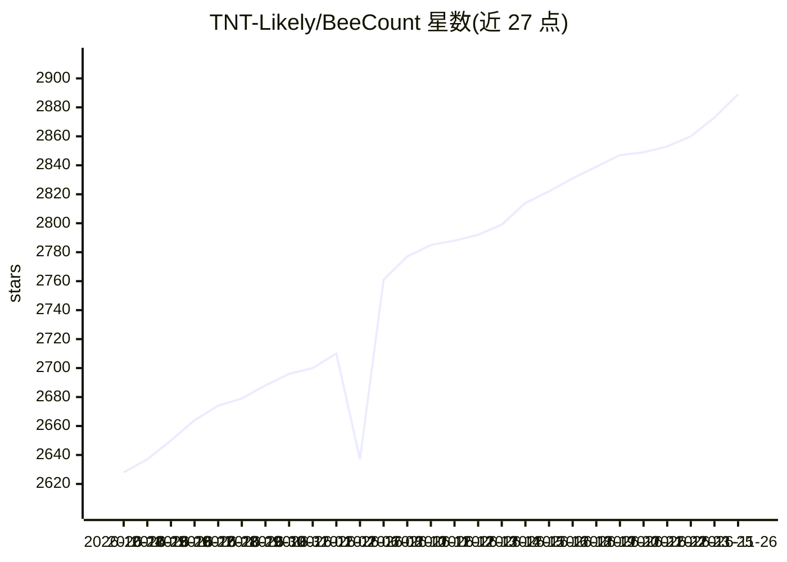

# TNT-Likely/BeeCount

⭐ 2,889 · Dart · NOASSERTION · 推送 2026-11-25 · [GitHub](https://github.com/TNT-Likely/BeeCount) · [官网](https://count.beejz.com) · 个人维护 · 中文 README

**本地优先的开源跨端记账应用，含 AI 记账**

基于 Flutter 开发的个人财务管理与支出追踪应用，覆盖 Android/iOS/Web，数据默认本地存储，支持 BeeCount Cloud 自建云、iCloud、Supabase、WebDAV、S3 五种同步方案。AI 部分包括自然语言对话记账、OCR 拍照记账（本地 TFLite 与云端双引擎）、语音记账与截图自动记账。基础功能覆盖多账本、多账户、预算、周期记账、CSV 导入导出与桌面小组件。许可证为 BSL，个人使用免费，商业使用需付费授权；HarmonyOS 版本已停止更新。

## 筛选速览

| 维度 | 判定 | 备注 |
|---|---|---|
| AI 角色 | `ai-enhanced` | 去掉 AI 部分产品仍成立 |
| 许可风险 | `none` | NOASSERTION |
| 部署形态 | `self-host` | docker 或自建部署 |
| 模型依赖 | — | README 未给出锁定关系 |
| 硬件要求 | — | 无带数字的原话,不猜 |
| 安装摩擦 | `low` | 无编译、无系统依赖或容器化 |
| 成熟度 | — | 结构信号不足 |

## 能力要点

- AI 对话/OCR/语音/截图四种记账方式，OCR 为本地 TFLite+云端双引擎
- 五种同步方案：自建云、iCloud、Supabase、WebDAV、S3
- MCP 支持：搭配 BeeCount Cloud 用 LLM 管理账本
- 桌面小组件 8 类内容、14 种规格

## 适用场景

- 在 Android/iOS 上离线记账并用 iCloud 或自建云同步
- 拍支付宝/微信截图或说话自动生成账目
- 家人共享一本账本并区分记录者
- 无 NAS 用户用 Supabase 做跨平台同步

## 场景标签

`OCR` · 领域:感知与多模态

## 证据(README 行号)

> L10: **你的数据,你做主的开源记账应用**
> L58:  🤖 AI 智能记账 — AI 对话 / OCR / 语音 / 截图自动识别
> L61: - **OCR 拍照记账** — 双引擎(本地 TFLite + GLM 云端),识别支付宝/微信/云闪付截图

## 星数曲线

2026-10-24 2,628 → 2026-11-26 2,889（+261）

---
*卡片 v1 · prompt 1.4 · 生成 2026-11-23 · 置信度 mid · 依据 README sha `6a6f5145375d` · [字段定义](../../DATASET.md)*
