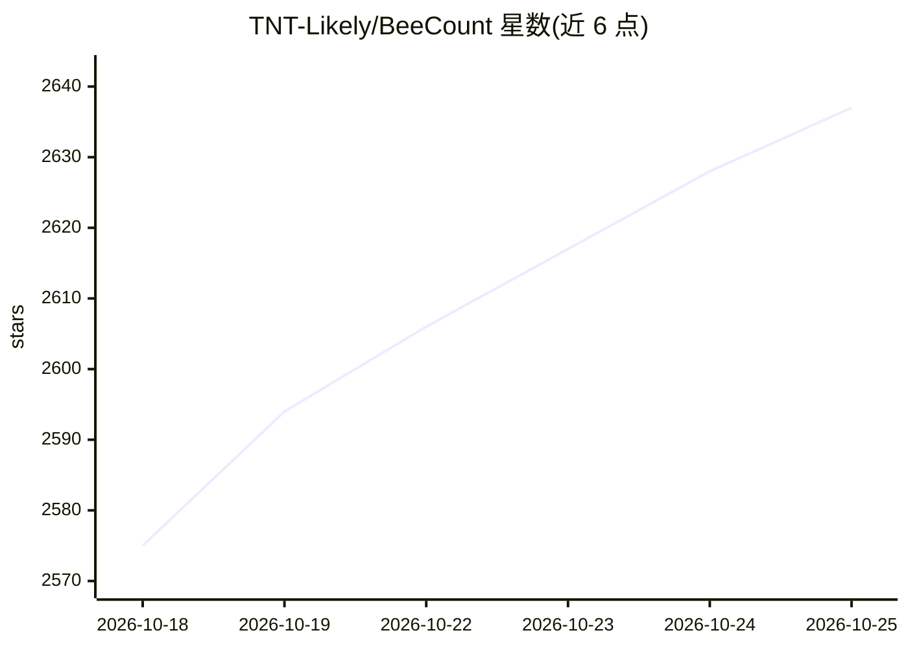

# TNT-Likely/BeeCount

⭐ 2,650 · Dart · NOASSERTION · 推送 2026-10-25 · [GitHub](https://github.com/TNT-Likely/BeeCount) · [官网](https://count.beejz.com) · 个人维护 · 中文 README

**本地优先的跨端开源记账应用，支持 AI 记账与自建云同步**

用 Flutter 开发的个人财务记账 App，覆盖 iOS/Android/Web 三端，核心功能包括多账本、多账户、二级分类、预算、周期记账、标签、图表分析与 CSV/YAML 导入导出。AI 部分提供自然语言对话记账、双引擎 OCR（本地 TFLite + GLM 云端）、语音记账与截图自动记账，基于智谱 GLM-4；另支持 MCP 搭配自建云用 LLM 管账本。同步支持 BeeCount Cloud 自建（Docker 部署、多用户、共享账本）、iCloud、Supabase、WebDAV、S3 五种方案，默认本地存储可脱离云使用。采用 BSL 许可，个人使用免费、商业使用需付费授权；鸿蒙版已停止更新。

## 筛选速览

| 维度 | 判定 | 备注 |
|---|---|---|
| AI 角色 | `ai-enhanced` | 去掉 AI 部分产品仍成立 |
| 许可风险 | `none` | NOASSERTION |
| 部署形态 | `self-host` | docker 或自建部署 |
| 模型依赖 | — | README 未给出锁定关系 |
| 硬件要求 | — | 无带数字的原话,不猜 |
| 安装摩擦 | `low` | 无编译、无系统依赖或容器化 |
| 成熟度 | — | 结构信号不足 |

## 能力要点

- AI 对话/OCR（本地 TFLite + GLM 云端双引擎）/语音/截图四种记账入口
- 5 种云同步方案：自建 BeeCount Cloud（Docker、多用户、共享账本）、iCloud、Supabase、WebDAV、S3
- MCP 支持，搭配自建云可用 LLM 直接管理账本
- 离线优先，本地 SQLite（Drift）存储，不配云服务功能完整可用

## 适用场景

- 我在手机上记账并跨设备同步，数据放在自己的服务器或 iCloud 里
- 我用拍照或说一句话的方式快速记一笔账
- 我和家人共享一本账，各自记录并看到谁记的每一笔

## 场景标签

 · 领域:个人财务/记账应用

## 证据(README 行号)

> L30: 一款轻量、开源、隐私可控的**个人财务管理**和**支出追踪** App。
> L46:  🤖 AI 智能记账 — AI 对话 / OCR / 语音 / 截图自动识别

## 星数曲线

2026-10-18 2,575 → 2026-10-25 2,637（+62）

---
*卡片 v1 · prompt 1.4 · 生成 2026-10-21 · 置信度 high · 依据 README sha `4c563871c2e8` · [字段定义](../../DATASET.md)*
