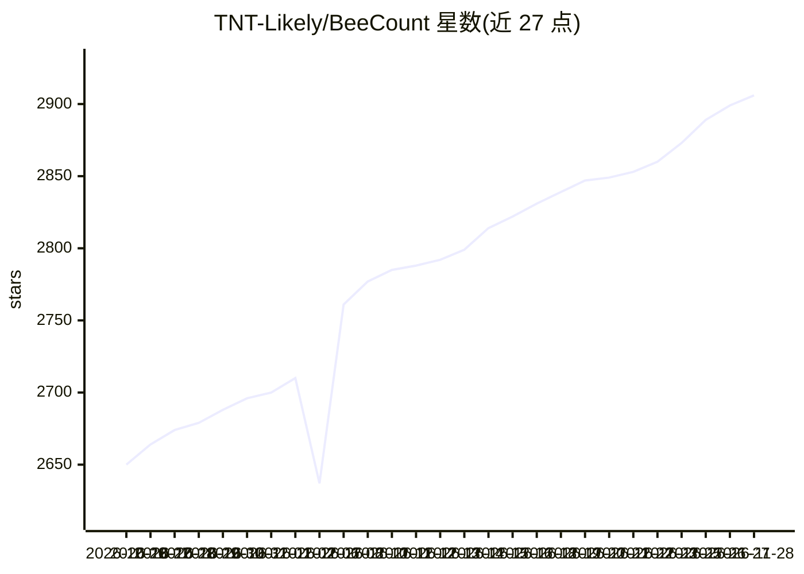

# TNT-Likely/BeeCount

⭐ 2,906 · Dart · NOASSERTION · 推送 2026-11-27 · [GitHub](https://github.com/TNT-Likely/BeeCount) · [官网](https://count.beejz.com) · 个人维护 · 中文 README

**本地优先的跨端开源记账应用，含AI记账与多种自建同步**

基于 Flutter 的个人记账应用，支持 iOS/Android/Web 三端，提供多账本、多账户、二级分类、预算、周期记账、标签与图表等基础记账功能。数据默认本地存储，支持 BeeCount Cloud 自建、iCloud、Supabase、WebDAV、S3 五种同步方案。AI 部分提供自然语言对话记账、OCR 票据识别（本地 TFLite + 云端双引擎）、语音记账与截图自动记账，云端模型基于智谱 GLM。采用 BSL 许可，商业使用需付费授权；HarmonyOS 版本已停止更新。

## 筛选速览

| 维度 | 判定 | 备注 |
|---|---|---|
| AI 角色 | `ai-enhanced` | 去掉 AI 部分产品仍成立 |
| 许可风险 | `none` | NOASSERTION |
| 部署形态 | `self-host` | docker 或自建部署 |
| 模型依赖 | — | README 未给出锁定关系 |
| 硬件要求 | — | 无带数字的原话,不猜 |
| 安装摩擦 | `low` | 无编译、无系统依赖或容器化 |
| 成熟度 | — | 结构信号不足 |

## 能力要点

- AI 对话 / OCR / 语音 / 截图四种自动记账方式
- 5 种同步方案（自建云/iCloud/Supabase/WebDAV/S3）
- 离线优先，无云配置也可完整使用
- 桌面小组件 8 类内容、14 种规格

## 适用场景

- 多设备同步记账，数据由自己掌控
- 拍照或截图自动识别账单并入账
- 家人或团队共享同一本账本
- 导入支付宝/微信 CSV 账单做支出分析

## 场景标签

`OCR` · 领域:感知与多模态

## 证据(README 行号)

> L42: 一款轻量、开源、隐私可控的**个人财务管理**和**支出追踪** App。
> L60: - **AI 小助手** — 自然语言对话记账,智能理解意图,基于智谱 GLM-4
> L65:  📝 基础记账 — 多账本 / 多账户 / 二级分类 / 预算 / 周期记账 / 标签 / 图表 / 导入导出

## 星数曲线

2026-10-26 2,650 → 2026-11-28 2,906（+256）

---
*卡片 v1 · prompt 1.4 · 生成 2026-11-26 · 置信度 mid · 依据 README sha `422b4ba2a26e` · [字段定义](../../DATASET.md)*
