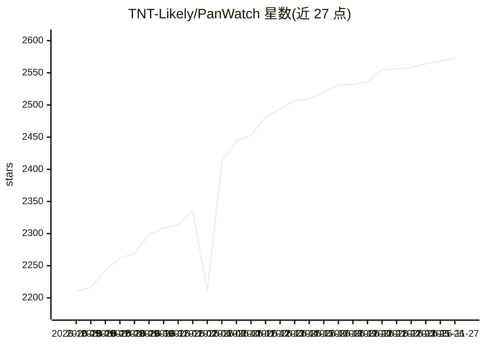

# TNT-Likely/PanWatch

⭐ 2,573 · Python · MIT · 推送 2026-11-26 · [GitHub](https://github.com/TNT-Likely/PanWatch) · [官网](https://github.com/TNT-Likely/PanWatch#quick-start) · 个人维护 · 中文 README

**自托管的 A股/港股/美股 AI 盯盘与持仓分析工具**

自托管的股票监控应用：管理多券商账户持仓与盈亏，通过 TradingAgents 多智能体流程（技术/情绪/新闻/基本面四个分析师角色、多空辩论、风险评审、PM 决策）对持仓做深度研究，并按交易日历执行盘前/盘中/收盘的定时 agent 工作流。支持 AI 打分的候选机会、组合条件价格提醒、基于信号与 T+1/T+2 结算规则的模拟交易，报告可推送至 Telegram/企业微信/钉钉/飞书/Bark/webhook。通过 Docker 部署，模型服务由用户自配 OpenAI 兼容接口或本地 Ollama。

## 筛选速览

| 维度 | 判定 | 备注 |
|---|---|---|
| AI 角色 | `ai-native` | 本体是模型或模型工具 |
| 许可风险 | `permissive` | MIT |
| 部署形态 | `self-host` | docker 或自建部署 |
| 模型依赖 | local-ok | 支持本地模型 |
| 硬件要求 | — | 无带数字的原话,不猜 |
| 安装摩擦 | `low` | 无编译、无系统依赖或容器化 |
| 成熟度 | `idea` | |

## 能力要点

- TradingAgents 九智能体深度研究：多空辩论、风险评审、PM 决策备忘录
- 按市场日历执行的盘前/盘中/收盘定时 agent 工作流
- 组合条件价格提醒（AND/OR 逻辑、冷却、每日上限、到期）
- 模拟交易含 A股 T+1、港股 T+2 等结算规则与现金账户模型

## 适用场景

- 让 AI agent 团队定时分析我的持仓并给出决策备忘录
- 设置多条件组合的价格提醒并推送到企业微信/Telegram
- 在真实下单前用模拟盘跟踪信号表现
- 自托管部署，用自己的模型额度跑盯盘分析

## 场景标签

`多智能体` `金融量化` · 领域:Agent 开发

## 证据(README 行号)

> L5:  Monitor A-shares, Hong Kong, and U.S. stocks, manage your portfolios, and research ideas with TradingAgents. Self-h
> L25: > 🧠 **Start from a portfolio holding → let a nine-agent TradingAgents research team analyze it → follow the bull/be
> L60: |**Scheduled agents**|Run pre-market, intraday, and closing workflows on eligible exchange trading days using your 

## 星数曲线

2026-10-25 2,211 → 2026-11-27 2,573（+362）

---
*卡片 v1 · prompt 1.4 · 生成 2026-11-26 · 置信度 mid · 依据 README sha `71c07f83eeb3` · [字段定义](../../DATASET.md)*
