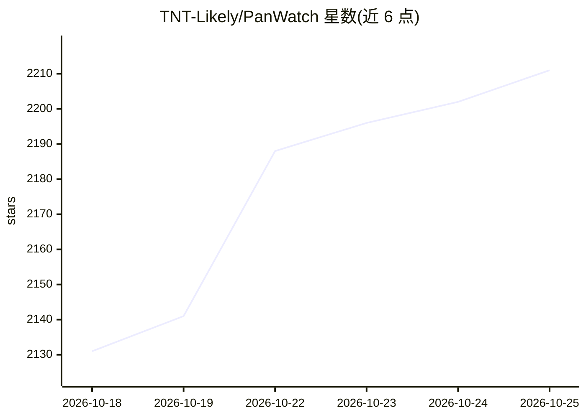

# TNT-Likely/PanWatch

⭐ 2,211 · Python · MIT · 推送 2026-10-23 · [GitHub](https://github.com/TNT-Likely/PanWatch) · [官网](https://github.com/TNT-Likely/PanWatch#quick-start) · 个人维护 · 中文 README

**自托管的 AI 股票盯盘与持仓分析应用（A股/港股/美股）**

面向个人投资者的自托管 Web 应用：管理多券商账户持仓与盈亏，覆盖 A股/港股/美股的搜索、行情、技术指标与价格提醒（AND/OR 组合条件）。AI 部分基于 TradingAgents 九 agent 架构做深度个股分析（技术/情绪/新闻/基本面分析师、多空辩论、风险审查、PM 决策），支持 OpenAI 兼容服务或 Ollama 本地模型，并可按交易日调度盘前/盘中/收盘 agent 工作流，报告经 Telegram/企微/钉钉/飞书/Bark 推送。附带 T+1/T+2 规则模拟的纸面交易与 PWA 移动端。通过 Docker 一键部署。

## 筛选速览

| 维度 | 判定 | 备注 |
|---|---|---|
| AI 角色 | `ai-native` | 本体是模型或模型工具 |
| 许可风险 | `permissive` | MIT |
| 部署形态 | `self-host` | docker 或自建部署 |
| 模型依赖 | local-ok | 支持本地模型 |
| 硬件要求 | — | 无带数字的原话,不猜 |
| 安装摩擦 | `low` | 无编译、无系统依赖或容器化 |
| 成熟度 | — | 结构信号不足 |

## 能力要点

- TradingAgents 九 agent 深度分析（四分析师+多空辩论+风险审查+PM 决策）
- 盘前/盘中/收盘 agent 按交易日历调度，过滤交易所休市日
- 价格提醒支持 AND/OR 组合条件、冷却与每日限额，多通知渠道（Telegram/企微/钉钉/飞书/Bark/webhook）
- 纸面交易按 A股 T+1、港股 T+2、美股 T+1 结算规则模拟

## 适用场景

- 自托管地盯盘 A股/港股/美股并接收实时提醒与自动报告
- 对持仓发起多 agent 深度研究并跟踪完整推理链
- 用本地模型（Ollama）做不外发数据的 AI 盘面分析
- 用纸面交易验证信号并跟踪收益曲线

## 场景标签

`金融量化` · 领域:学习与行业

## 证据(README 行号)

> L5:  Monitor A-shares, Hong Kong, and U.S. stocks, manage your portfolios, and research ideas with TradingAgents. Self-h
> L23: > 🧠 **Start from a portfolio holding → let a nine-agent TradingAgents research team analyze it → follow the bull/be
> L48: |**AI research**|Follow technical, sentiment, news, and fundamentals analysis through debate, risk review, and a po

## 星数曲线

2026-10-18 2,131 → 2026-10-25 2,211（+80）

---
*卡片 v1 · prompt 1.4 · 生成 2026-10-21 · 置信度 mid · 依据 README sha `134bb01ff0b2` · [字段定义](../../DATASET.md)*
