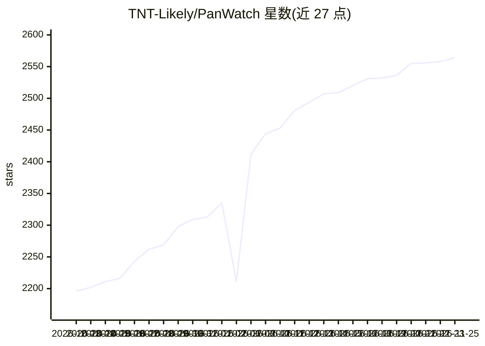

# TNT-Likely/PanWatch

⭐ 2,564 · Python · MIT · 推送 2026-11-23 · [GitHub](https://github.com/TNT-Likely/PanWatch) · [官网](https://github.com/TNT-Likely/PanWatch#quick-start) · 个人维护 · 中文 README

**自托管 AI 股票盯盘应用，覆盖A股/港股/美股**

自托管的股票监控 Web 应用：管理多券商账户持仓与盈亏、AND/OR 组合条件价格提醒、AI 评分机会列表、模拟交易，以及基于 TradingAgents 的深度分析——四个分析师角色进入多空辩论、风险审查与基金经理决策。定时 agent 在交易日运行盘前/盘中/收盘工作流，报告经 Telegram、企业微信、钉钉、飞书、Bark 或 webhook 通知。通过 Docker 部署，需在设置中接入 OpenAI 兼容模型服务或经 Ollama 使用本地模型；ETF 的持仓、费率等结构化数据尚未提供。

## 筛选速览

| 维度 | 判定 | 备注 |
|---|---|---|
| AI 角色 | `ai-enhanced` | 去掉 AI 部分产品仍成立 |
| 许可风险 | `permissive` | MIT |
| 部署形态 | `self-host` | docker 或自建部署 |
| 模型依赖 | local-ok | 支持本地模型 |
| 硬件要求 | — | 无带数字的原话,不猜 |
| 安装摩擦 | `low` | 无编译、无系统依赖或容器化 |
| 成熟度 | — | 结构信号不足 |

## 能力要点

- TradingAgents 多 agent 研究流程：多空辩论+风险审查+PM 决策备忘录
- 多账户组合管理与模拟交易，内置 A股 T+1、港股 T+2 等结算规则
- 盘前/盘中/收盘定时 agent 与市场日历过滤（节假日、半日市）
- PWA 可安装到手机主屏，另有 Android 应用经 QR 连接服务器

## 适用场景

- 自动盯盘并在异动时收到实时提醒
- 让多 agent 研究流程分析我的持仓并输出决策备忘录
- 用模拟交易验证信号策略而不投入真实资金
- 通过钉钉/飞书/Telegram 接收每日收盘报告

## 场景标签

`金融量化` `多智能体` · 领域:Agent 开发

## 证据(README 行号)

> L1: PanWatch — Self-hosted AI stock monitoring
> L23: > 🧠 **Start from a portfolio holding → let a nine-agent TradingAgents research team analyze it → follow the bull/be
> L56: |**Portfolio**|Manage multiple brokerage accounts, track holdings and P&L, and set trading styles.|

## 星数曲线

2026-10-23 2,196 → 2026-11-25 2,564（+368）

---
*卡片 v1 · prompt 1.4 · 生成 2026-11-24 · 置信度 mid · 依据 README sha `999165927eea` · [字段定义](../../DATASET.md)*
