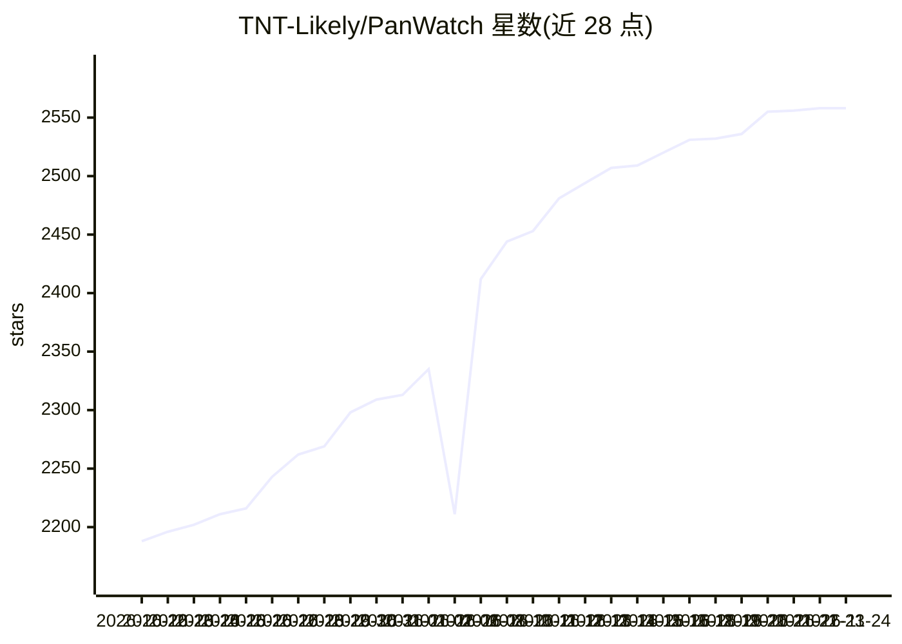

# TNT-Likely/PanWatch

⭐ 2,558 · Python · MIT · 推送 2026-11-22 · [GitHub](https://github.com/TNT-Likely/PanWatch) · [官网](https://github.com/TNT-Likely/PanWatch#quick-start) · 个人维护 · 中文 README

**自托管的A股/港股/美股 AI 盯盘与持仓分析系统**

自托管的股票监控 Web 应用（含 PWA 与移动端连接）：管理多券商账户持仓与盈亏、价格条件提醒、模拟交易、技术指标（MACD/RSI/KDJ/布林带）与 AI 评分机会列表。核心机制为 TradingAgents 九角色研究流程：分析师输出经多空辩论、风险审查后生成 PM 决策备忘录，并推送至 Telegram/企业微信/钉钉/飞书等渠道；支持盘前/盘中/收盘定时 agent 与交易所日历过滤。模型通过 OpenAI 兼容接口配置或本地 Ollama 接入；ETF 深度分析不含基金持仓、费率等结构化数据。

## 筛选速览

| 维度 | 判定 | 备注 |
|---|---|---|
| AI 角色 | `ai-native` | 本体是模型或模型工具 |
| 许可风险 | `permissive` | MIT |
| 部署形态 | `self-host` | docker 或自建部署 |
| 模型依赖 | local-ok | 支持本地模型 |
| 硬件要求 | — | 无带数字的原话,不猜 |
| 安装摩擦 | `low` | 无编译、无系统依赖或容器化 |
| 成熟度 | — | 结构信号不足 |

## 能力要点

- TradingAgents 深度分析：四个分析师角色→多空辩论→风险审查→PM 决策，附完整推理链
- 盘前/盘中/收盘定时 agent，自动过滤交易所节假日与休市时段
- A股 T+1、港股 T+2、美股 T+1 的模拟交易结算模型
- 通知渠道覆盖 Telegram、企业微信、钉钉、飞书、Bark 与 webhook

## 适用场景

- 让多角色 AI agent 对我的持仓做深度研究并推送决策备忘录
- 按自定义条件在交易时段接收价格提醒
- 用模拟交易验证信号策略并跟踪资金曲线

## 场景标签

`金融量化` · 领域:学习与行业

## 证据(README 行号)

> L5:  Monitor A-shares, Hong Kong, and U.S. stocks, manage your portfolios, and research ideas with TradingAgents. Self-h
> L23: > 🧠 **Start from a portfolio holding → let a nine-agent TradingAgents research team analyze it → follow the bull/be
> L144: Select the brain icon beside a holding to start TradingAgents deep analysis. Four analyst roles feed a bull/bear d

## 星数曲线

2026-10-22 2,188 → 2026-11-24 2,558（+370）

---
*卡片 v1 · prompt 1.4 · 生成 2026-11-23 · 置信度 mid · 依据 README sha `5fecc176ce9a` · [字段定义](../../DATASET.md)*
