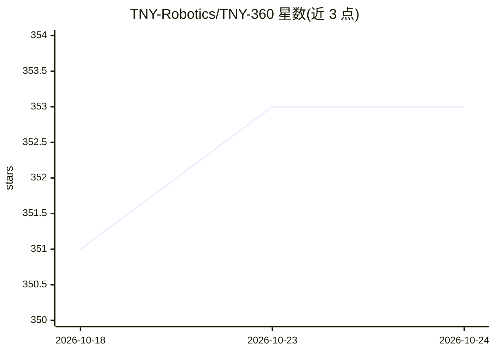

# TNY-Robotics/TNY-360

⭐ 353 · C++ · NOASSERTION · 推送 2026-10-23 · [GitHub](https://github.com/TNY-Robotics/TNY-360) · [官网](https://tny-robotics.com/tny-360) · 组织维护

**开源四足机器狗的完整源码与硬件设计（含 3D/PCB/固件）**

TNY Robotics 团队维护的开源机器狗项目，提供全套自制资料：BOM 物料清单、FreeCAD 工程与可打印 STL、自制 PCB 的 Gerber 文件、以及基于 PlatformIO（C++/ESP-IDF）的 ESP32-S3 固件与传感器驱动。硬件采用 12 个改装位置反馈的 MG996R 舵机、200Hz 闭环控制、双核架构（Core 1 运行运动学控制环、Core 0 处理 WebSocket/UI），带摄像头、ToF 测距、IMU 等传感器，并可通过积木式 Web 应用 TNY-Coder 编程。许可为 CC BY-NC-SA 4.0，限非商业用途。

## 筛选速览

| 维度 | 判定 | 备注 |
|---|---|---|
| AI 角色 | `ai-enhanced` | 去掉 AI 部分产品仍成立 |
| 许可风险 | `none` | NOASSERTION |
| 部署形态 | `None` |  |
| 模型依赖 | — | README 未给出锁定关系 |
| 硬件要求 | — | 无带数字的原话,不猜 |
| 安装摩擦 | `low` | 无编译、无系统依赖或容器化 |
| 成熟度 | — | 结构信号不足 |

## 能力要点

- 提供 BOM、CAD（FreeCAD/STL）、PCB Gerber 与固件的全套自制文件
- ESP32-S3 双核架构，200Hz 闭环运动学控制
- MG996R 舵机经 Op-Amp 改装获得位置反馈
- 支持 TNY-Coder 积木式 Web 编程与背部 I2C/电源扩展口

## 适用场景

- 按官方分步指南自制并组装一台开源机器狗
- 3D 打印结构件、打样自制 PCB 并烧录固件复现整机
- 在扩展口上开发自定义硬件模块或修改固件

## 场景标签

 · 领域:机器人/开源硬件

## 证据(README 行号)

> L34: * 🧬 **Dual-Core Architecture:** A segregated system using the ESP32-S3. Core 1 ("Reflex") runs a strict 200Hz kinem
> L53: * **Vision:** OV2640 Camera Module

## 星数曲线

2026-10-18 351 → 2026-10-24 353（+2）

---
*卡片 v1 · prompt 1.4 · 生成 2026-10-21 · 置信度 low · 依据 README sha `5c6287de97e0` · [字段定义](../../DATASET.md)*
