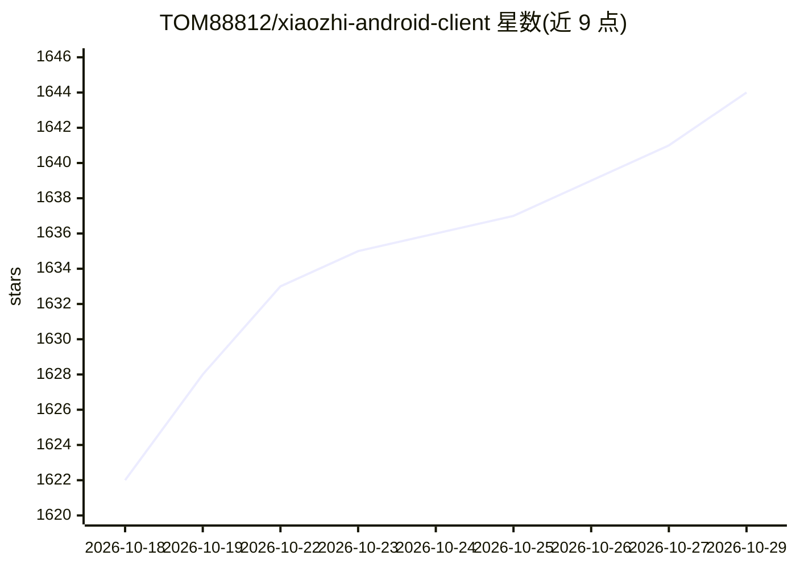

# TOM88812/xiaozhi-android-client

⭐ 1,644 · Dart · Apache-2.0 · 推送 2026-09-18 · [GitHub](https://github.com/TOM88812/xiaozhi-android-client) · [官网](https://jtai.lhht.cc) · 个人维护 · 中文 README

**基于小智 AI 的跨平台实时语音对话客户端，覆盖手机与 PC**

面向终端用户的 AI 语音助手客户端：基于小智 AI 与 xiaozhi-server，提供实时语音对话（支持打断）、文字对话、Live2D/3D 模型展示、IoT 设备控制与多小智服务管理。V3 为 Flutter 跨平台版本，覆盖 Android、iOS、HarmonyOS、Web、Windows、macOS、Linux；另提供购买商业版获赠的 V1 原生安卓/鸿蒙客户端，面向 AI 硬件终端场景。支持 OpenAI 等服务、MCP 调用、WS/MQTT 协议，服务端商业版含音色克隆、声纹识别、会员制等功能。

## 筛选速览

| 维度 | 判定 | 备注 |
|---|---|---|
| AI 角色 | `ai-native` | 本体是模型或模型工具 |
| 许可风险 | `permissive` | Apache-2.0 |
| 部署形态 | `None` |  |
| 模型依赖 | — | README 未给出锁定关系 |
| 硬件要求 | — | 无带数字的原话,不猜 |
| 安装摩擦 | `low` | 无编译、无系统依赖或容器化 |
| 成熟度 | — | 结构信号不足 |

## 能力要点

- 实时语音对话与语音打断、文字对话
- Flutter 一套代码覆盖 Android/iOS/HarmonyOS/Web/Windows/macOS/Linux
- Live2D 与 3D 模型展示、AI 驱动模型表达情绪
- 支持 OpenAI 等服务、MCP 调用、WS/MQTT 协议与多小智服务

## 适用场景

- 手机上与小智 AI 进行实时语音和文字对话
- 作为 AI 硬件/智能体设备的终端客户端与 IoT 中控
- 多助手管理并与硬件端互通记忆

## 场景标签

`语音 Agent` · 领域:对话与助手

## 证据(README 行号)

> L9:  基于小智AI的实时语音对话应用 · 支持实时语音交互与文字对话
> L76: - ✅ **实时语音交互** — 实时语音对话与文字对话，支持实时打断
> L96: > 基于 Flutter 框架，一套代码覆盖 Android、iOS、HarmonyOS、Web、Windows、macOS、Linux，深度适配自研服务端。

## 星数曲线

2026-10-18 1,622 → 2026-10-29 1,644（+22）

---
*卡片 v1 · prompt 1.4 · 生成 2026-10-21 · 置信度 high · 依据 README sha `65d3f1848f81` · [字段定义](../../DATASET.md)*
