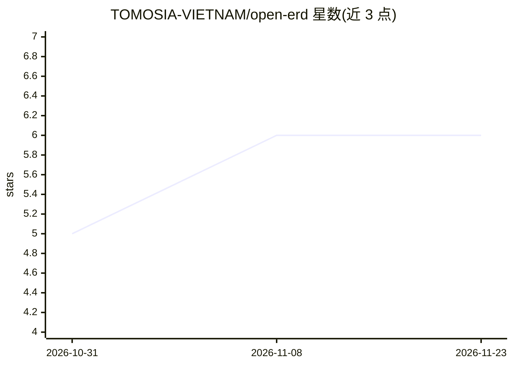

# TOMOSIA-VIETNAM/open-erd

⭐ 6 · JavaScript · MIT · 推送 2026-11-02 · [GitHub](https://github.com/TOMOSIA-VIETNAM/open-erd) · [官网](https://tomosia-vietnam.github.io/open-erd/) · 组织维护

**AI agent 从源码生成项目 ERD 的 Claude Code 插件**

以 Claude Code / Codex 插件形式提供的 ERD 生成工具：agent 读取模型、迁移与关联代码（含多态关联），即使数据库未声明外键也能推断关系，并用第二个 agent 核对每个事实后提交。输出可在浏览器打开的交互式 erd.svg，附 Excel 与 draw.io 版本；提供命令面板搜索、两表连接路径、PII 标注、schema 健康发现与领域漫游功能，代码变更后可用 sync 命令更新。安全声明为只读文件、不启动应用、不写仓库。

## 筛选速览

| 维度 | 判定 | 备注 |
|---|---|---|
| AI 角色 | `ai-native` | 本体是模型或模型工具 |
| 许可风险 | `permissive` | MIT |
| 部署形态 | `None` |  |
| 模型依赖 | — | README 未给出锁定关系 |
| 硬件要求 | — | 无带数字的原话,不猜 |
| 安装摩擦 | `low` | 无编译、无系统依赖或容器化 |
| 成熟度 | — | 结构信号不足 |

## 能力要点

- 从模型/迁移/关联代码推断关系，无外键也可用（含多态关联）
- 第二个 agent 交叉核对推断的事实后提交
- 输出交互式 erd.svg + Excel + draw.io 三种格式
- PII 高亮、schema 健康发现、两表 JOIN 路径与 SELECT 语句

## 适用场景

- 为遗留项目补充数据模型文档
- 代码变更后同步更新 ERD
- 梳理数据库中个人数据字段分布
- 向团队演示各领域数据模型

## 场景标签

 · 领域:开发者工具/数据库文档

## 证据(README 行号)

> L3:  An ERD of any project, drawn by an agent from its source code.
> L13: - **Finds the relations the database never declared**: reads models,
> L41: /plugin marketplace add TOMOSIA-VIETNAM/open-erd

## 星数曲线

2026-10-31 5 → 2026-11-23 6（+1）

---
*卡片 v1 · prompt 1.4 · 生成 2026-11-20 · 置信度 high · 依据 README sha `4593dc583118` · [字段定义](../../DATASET.md)*
