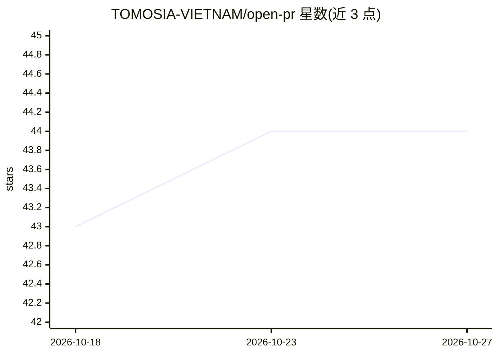

# TOMOSIA-VIETNAM/open-pr

⭐ 44 · Python · MIT · 推送 2026-10-26 · [GitHub](https://github.com/TOMOSIA-VIETNAM/open-pr) · [官网](https://open-pr.vercel.app) · 组织维护

**把 AI 代码审查直接落到 PR 上的自托管插件**

面向 GitHub/GitLab/Bitbucket 的开源 AI 代码审查插件，以命令（/open-pr:review、:fix、:watch）运行在已有的 agent CLI（Claude Code、Cursor、Codex、Gemini CLI、Antigravity）中，不自带服务端或机器人账号。审查结果以一条总览、行内评论（含建议修改）和修复后的回复形式发布在 PR 上；通过读取 README/CLAUDE.md/AGENTS.md/docs/wiki 学习仓库约定，并将团队纠正写入仓库记忆供下次使用。修复严格限制为 1 个 commit、不 force-push；无 Bitbucket 官方 CLI 时改用环境变量凭据。

## 筛选速览

| 维度 | 判定 | 备注 |
|---|---|---|
| AI 角色 | `ai-ecosystem` | LLM/agent 周边工具 |
| 许可风险 | `permissive` | MIT |
| 部署形态 | `None` |  |
| 模型依赖 | — | README 未给出锁定关系 |
| 硬件要求 | — | 无带数字的原话,不猜 |
| 安装摩擦 | `low` | 无编译、无系统依赖或容器化 |
| 成熟度 | — | 结构信号不足 |

## 能力要点

- 一次请求只产出 1 条审查（总览+行内评论+回复），不刷评论流
- 读取 README/CLAUDE.md/AGENTS.md/wiki，仓库规则优先于通用规则
- 团队在 PR 上的纠正可写入仓库记忆并在下次运行生效
- /open-pr:fix 每次仅 1 个 commit、不改写历史，并逐线程回复

## 适用场景

- 让我自己先跑一轮 AI 审查再交给人工评审
- 用 watcher 常驻监听 PR 评论自动审查与修复自己的 PR
- 按仓库约定和团队纠正持续做 PR 审查

## 场景标签

`代码审查` · 领域:编码与开发

## 证据(README 行号)

> L36: - **Open source, no `open-pr` service** — MIT-licensed, no `open-pr` server or bot account; it runs in the agent CL
> L42: **1. A vendor CLI, logged in.** The plugin carries no credential of its own — it reads the PR and posts the review 
> L60: **Install for Cursor, Codex, Gemini CLI, Antigravity:**

## 星数曲线

2026-10-18 43 → 2026-10-27 44（+1）

---
*卡片 v1 · prompt 1.4 · 生成 2026-10-25 · 置信度 high · 依据 README sha `644492910cdc` · [字段定义](../../DATASET.md)*
