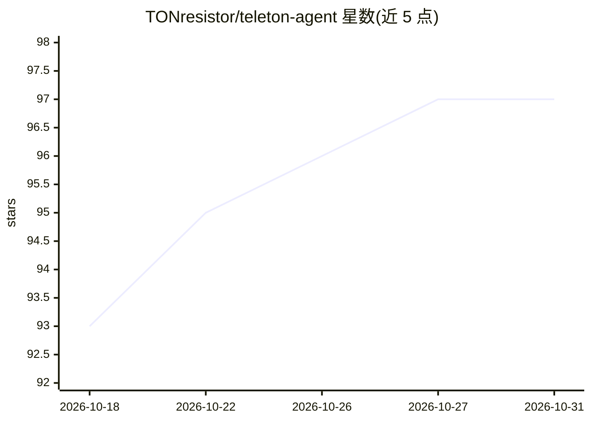

# TONresistor/teleton-agent

⭐ 97 · TypeScript · MIT · 推送 2026-10-26 · [GitHub](https://github.com/TONresistor/teleton-agent) · 组织维护

**面向 Telegram 的自主 AI Agent，集成 TON 区块链操作**

TypeScript 实现的自主 AI agent 平台：以用户账号（MTProto）或 Bot 身份接入 Telegram，通过 think-act-observe 循环调用 131 个内置工具（消息、媒体、TON 钱包/jetton、STON.fi 与 DeDust DEX、TON DNS 等），支持 16 家 LLM 提供商热切换、混合 RAG 记忆（sqlite-vec+FTS5）、自动上下文压缩、MCP 客户端、插件 SDK 与本地 WebUI 管理面板。提供 npm 全局安装、Docker 镜像与源码构建三种方式；需 Node.js 22+、LLM API key 与 Telegram 凭据，建议使用专用 Telegram 账号（存在封号风险提示）。

## 筛选速览

| 维度 | 判定 | 备注 |
|---|---|---|
| AI 角色 | `ai-native` | 本体是模型或模型工具 |
| 许可风险 | `permissive` | MIT |
| 部署形态 | `self-host` | docker 或自建部署 |
| 模型依赖 | local-ok | 支持本地模型 |
| 硬件要求 | — | 无带数字的原话,不猜 |
| 安装摩擦 | `low` | 无编译、无系统依赖或容器化 |
| 成熟度 | — | 结构信号不足 |

## 能力要点

- 131 个内置工具 + 5 个可选系统工具，覆盖 Telegram 与 TON 链上操作
- 16 家 LLM 提供商（含 Ollama/vLLM 本地运行时），运行时热切换
- 混合 RAG 记忆（sqlite-vec + FTS5）与自动上下文压缩
- MCP 客户端 + 插件 SDK + WebUI 管理面板

## 适用场景

- 在 Telegram 中部署可对话操作钱包与链上交易的 AI agent
- 自动化 Telegram 消息、媒体与群组管理
- 通过 MCP 与插件扩展自定义工具能力

## 场景标签

`Agent 框架` · 领域:Agent 开发

## 证据(README 行号)

> L3:  Autonomous AI agent platform for Telegram with native TON blockchain integration
> L12:  Teleton is an autonomous AI agent for Telegram (user account or bot). It loops with tools, keeps hybrid RAG memory
> L17:  <ins>Agentic Loop</ins> Think, act, observe, repeat until shit gets done

## 星数曲线

2026-10-18 93 → 2026-10-31 97（+4）

---
*卡片 v1 · prompt 1.4 · 生成 2026-10-23 · 置信度 high · 依据 README sha `09634998c0b5` · [字段定义](../../DATASET.md)*
