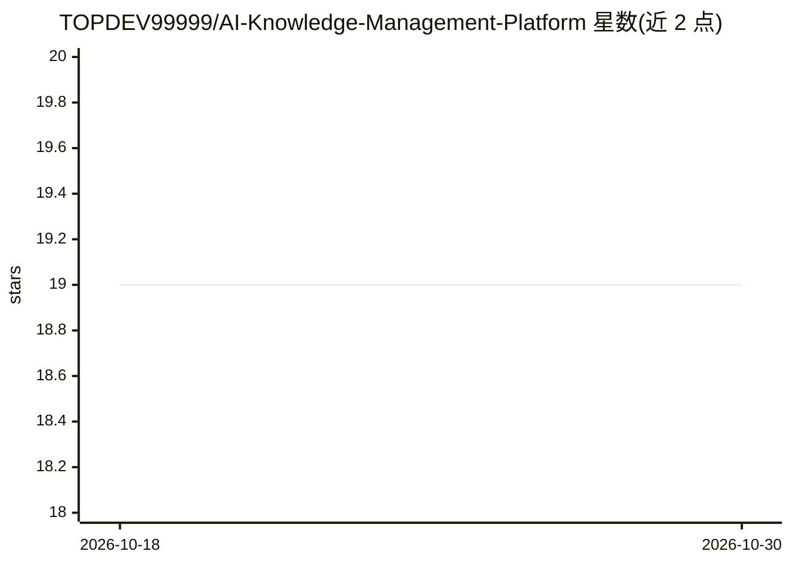

# TOPDEV99999/AI-Knowledge-Management-Platform

⭐ 19 · Jupyter Notebook · MIT-0 · 推送 2026-08-03 · [GitHub](https://github.com/TOPDEV99999/AI-Knowledge-Management-Platform) · [官网](https://tkaxis.com/) · 个人维护

**企业文档智能问答助手：RAG+SQL 分析的多步推理**

面向企业业务文档的对话式 LLM 助手：通过 RAG 语义检索回答事实性问题；将批量抽取的结构化实体存入数据库，把分析性问题（如合同到期查询）转换为 SQL 执行；采用 ReAct 架构的 LLM agent 组合检索、分析与外部工具处理多步复杂问题。项目包含 backend、frontend（Next.js 聊天应用带认证）、数据管道与实验模块。需自行配置 AI 模型提供商、API 凭证及数据库与向量存储，安装方式为克隆仓库后 npm 安装依赖。

## 筛选速览

| 维度 | 判定 | 备注 |
|---|---|---|
| AI 角色 | `ai-native` | 本体是模型或模型工具 |
| 许可风险 | `permissive` | MIT-0 |
| 部署形态 | `library` | 以包/库形式分发 |
| 模型依赖 | — | README 未给出锁定关系 |
| 硬件要求 | — | 无带数字的原话,不猜 |
| 安装摩擦 | `low` | 无编译、无系统依赖或容器化 |
| 成熟度 | — | 结构信号不足 |

## 能力要点

- RAG 语义检索回答事实性问题
- 实体抽取入库后经 SQL 生成回答分析性问题
- ReAct 架构 LLM agent 在检索/SQL/工具间决策
- 带认证的 Next.js 对话前端

## 适用场景

- 对合同等业务文档做自然语言问答与分析
- 查询需要跨文档统计分析的问题
- 多步骤推理组合检索与数据库查询

## 场景标签

`RAG` `文档问答` · 领域:知识与检索

## 证据(README 行号)

> L7: It supports answering factual questions by retrieving relevant information directly from documents using semantic se
> L9: Additionally, it can answer analytical questions such as *which contracts will expire in the next 3 months?* by conv
> L11: The assistant can also solve complex multi-step questions by combining document retrieval, analytical reasoning, an

## 星数曲线

2026-10-18 19 → 2026-10-30 19（+0）

---
*卡片 v1 · prompt 1.4 · 生成 2026-10-28 · 置信度 high · 依据 README sha `9ba104290590` · [字段定义](../../DATASET.md)*
