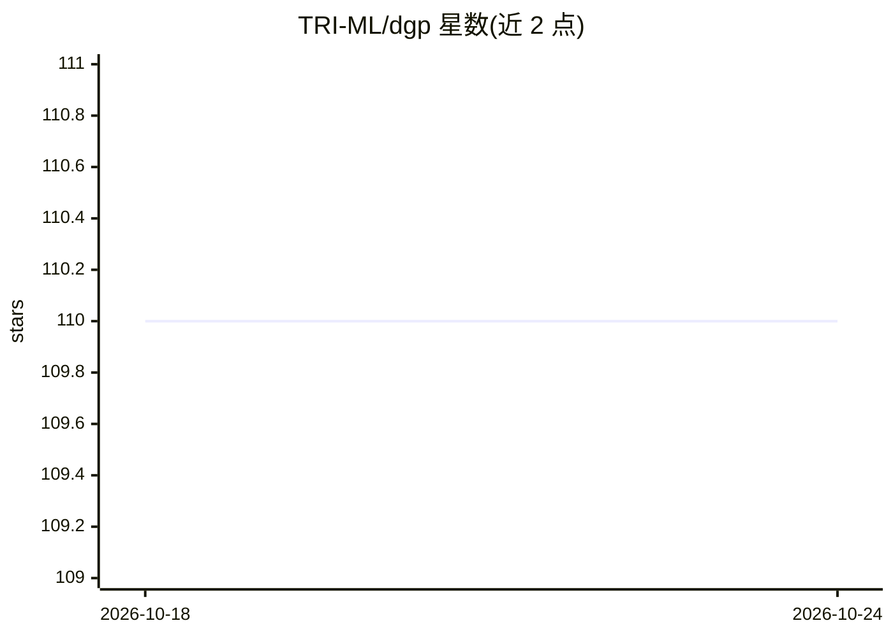

# TRI-ML/dgp

⭐ 110 · Python · MIT · 推送 2026-05-26 · [GitHub](https://github.com/TRI-ML/dgp) · [官网](https://tri-ml.github.io/dgp/) · 组织维护

**自动驾驶数据集的治理框架：定义 schema 并提供 PyTorch 加载器**

Toyota Research Institute 开发的数据集治理策略（DGP），用 Protobuf 定义原始数据、标注与数据集管理的 schema，用于保障 AV 数据集的可追溯性、可复现性与标准化。提供统一的 PyTorch Dataset 类加载所有符合 DGP 规范的数据集，以及用于数据集处理和可视化工具入口的 CLI。支持 Docker 构建、wheel 打包与本地开发测试，按 PEP 440 版本化。

## 筛选速览

| 维度 | 判定 | 备注 |
|---|---|---|
| AI 角色 | `ai-ecosystem` | LLM/agent 周边工具 |
| 许可风险 | `permissive` | MIT |
| 部署形态 | `self-host` | docker 或自建部署 |
| 模型依赖 | — | README 未给出锁定关系 |
| 硬件要求 | — | 无带数字的原话,不猜 |
| 安装摩擦 | `low` | 无编译、无系统依赖或容器化 |
| 成熟度 | — | 结构信号不足 |

## 能力要点

- Protobuf schema 覆盖原始数据、标注与数据集管理
- 统一 PyTorch Dataset 类加载全部 DGP 兼容数据集
- CLI 处理数据集并作为可视化工具入口
- 提供多模态（相机/激光雷达、2D/3D 框）加载示例

## 适用场景

- 按统一 schema 组织和管理自动驾驶多模态数据集
- 用统一 PyTorch Dataset 类加载多模态数据做训练
- 保证团队数据集的可追溯与可复现

## 场景标签

`MLOps` · 领域:训练与推理

## 证据(README 行号)

> L9: To ensure the traceability, reproducibility and standardization for all ML
> L21: - DataLoaders: Universal PyTorch DatasetClass to load all

## 星数曲线

2026-10-18 110 → 2026-10-24 110（+0）

---
*卡片 v1 · prompt 1.4 · 生成 2026-10-23 · 置信度 high · 依据 README sha `857e087696cb` · [字段定义](../../DATASET.md)*
