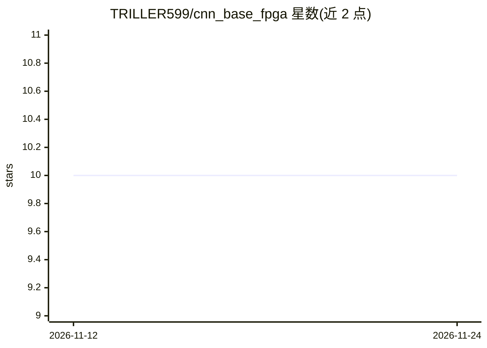

# TRILLER599/cnn_base_fpga

⭐ 10 · SystemVerilog · MIT · 推送 2026-09-01 · [GitHub](https://github.com/TRILLER599/cnn_base_fpga) · [官网](https://medium.com/@timuritalia87/training-large-neural-networks-on-fpgas-utopia-or-5907b4868415) · 个人维护

**在 FPGA 上实现 CNN 前向与反向传播训练的研究原型**

面向 FPGA 训练神经网络可行性探索的研究原型：在 FPGA 逻辑中实现小型卷积网络的前向与反向传播及权重更新，数据与参数经 10 GbE UDP 接口传输；同一网络另以纯 NumPy 实现作为软件参照模型用于结果比对。RTL 由类 C 硬件描述经 HLS 式转译生成，架构按流式接口设计、目标为跨多 FPGA 分区扩展。README 声明其为研究原型而非生产级框架，多 FPGA 分区仅为架构目标。

## 筛选速览

| 维度 | 判定 | 备注 |
|---|---|---|
| AI 角色 | `ai-native` | 本体是模型或模型工具 |
| 许可风险 | `permissive` | MIT |
| 部署形态 | `None` |  |
| 模型依赖 | — | README 未给出锁定关系 |
| 硬件要求 | — | 无带数字的原话,不猜 |
| 安装摩擦 | `low` | 无编译、无系统依赖或容器化 |
| 成熟度 | `idea` | |

## 能力要点

- SystemVerilog 实现 CNN 前向传播、反向传播与权重更新
- 纯 NumPy 参照模型与 FPGA 实现共用同一权重与参数做比对
- 10 GbE UDP 控制与数据传输接口
- 全流水线/并行 FPGA 数据通路，RTL 由 HLS 式转译生成

## 适用场景

- 验证在 FPGA 上训练神经网络并对比 GPU 方案的可行性
- 以 NumPy 参照模型比对硬件训练结果
- 研究跨多 FPGA 的网络层分区与流式接口设计

## 场景标签

`模型训练` · 领域:训练与推理

## 证据(README 行号)

> L3: Research prototype exploring the feasibility of training neural networks on multiple FPGAs, with the goal of reducin
> L27: - SystemVerilog implementation of CNN training, including forward propagation, backpropagation, and weight updates.
> L5: The project implements a small convolutional neural network with both **feed-forward** and **backpropagation** compu

## 星数曲线

2026-11-12 10 → 2026-11-24 10（+0）

---
*卡片 v1 · prompt 1.4 · 生成 2026-11-20 · 置信度 high · 依据 README sha `f790a0351c83` · [字段定义](../../DATASET.md)*
