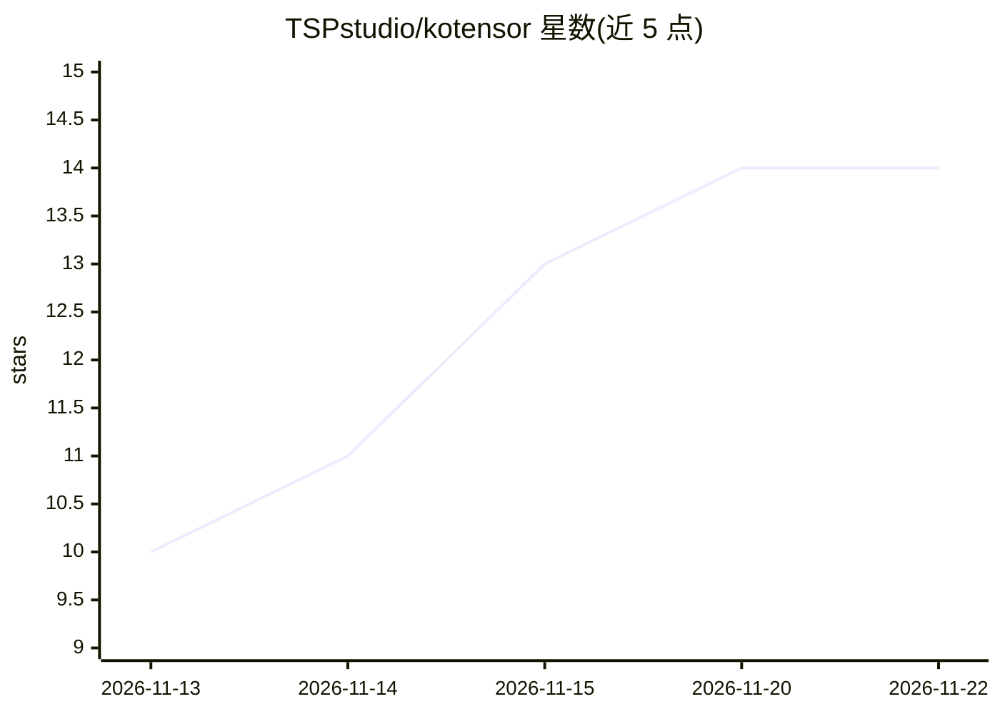

# TSPstudio/kotensor

⭐ 14 · Kotlin · Apache-2.0 · 推送 2026-11-12 · [GitHub](https://github.com/TSPstudio/kotensor) · [官网](https://tspstudio.github.io/kotensor/) · 个人维护

**在 JVM/Android 上纯 Kotlin 训练、微调并运行 Transformer LLM**

纯 Kotlin 实现的机器学习与生成式 Transformer 引擎：反向模式自动求导、KV 缓存解码、INT8/INT4 量化、BPE 分词、LoRA/QLoRA 微调以及 Hugging Face 检查点导入（Llama/Qwen2/Mistral 架构，.safetensors 格式）。唯一运行时依赖为 Kotlin 标准库，无 C++/Python/JNI，一个 JAR 覆盖服务器、桌面与手机。要求 Java 17+ / Android API 24+，发布于 Maven Central，附带 Android Compose 示例应用与 JMH 基准套件。

## 筛选速览

| 维度 | 判定 | 备注 |
|---|---|---|
| AI 角色 | `ai-native` | 本体是模型或模型工具 |
| 许可风险 | `permissive` | Apache-2.0 |
| 部署形态 | `None` |  |
| 模型依赖 | — | README 未给出锁定关系 |
| 硬件要求 | — | 无带数字的原话,不猜 |
| 安装摩擦 | `medium` | 含编译或系统依赖之一 |
| 成熟度 | — | 结构信号不足 |

## 能力要点

- 纯 Kotlin 实现全栈：张量、autograd、优化器、decoder-only Transformer、量化、分词、LoRA
- 读取 Hugging Face .safetensors 检查点（BF16/F16/F32），自带 byte-level BPE 分词器
- INT8/INT4 分组量化与内存映射加载，LoRA 可在量化权重上训练（QLoRA）
- 支持 Android 7.0+，附带 Compose 示例应用在手机上流式推理与微调

## 适用场景

- 在 Android 应用中离线运行量化后的 Llama/Qwen 模型
- 在 JVM 服务端用 Kotlin 从头训练小型语言模型
- 在设备端对预训练模型做 LoRA/QLoRA 微调
- 将 Hugging Face 检查点导入纯 JVM 环境推理

## 场景标签

`微调` `模型量化` `模型训练` · 领域:训练与推理

## 证据(README 行号)

> L17: Kotensor is a lightweight, pure-Kotlin machine learning and generative Transformer engine for JVM and Android appli
> L21: Kotensor implements the whole stack — tensors, reverse-mode autograd, optimizers, a modern decoder-only Transformer

## 星数曲线

2026-11-13 10 → 2026-11-22 14（+4）

---
*卡片 v1 · prompt 1.4 · 生成 2026-11-18 · 置信度 high · 依据 README sha `14d0eb08ecd9` · [字段定义](../../DATASET.md)*
