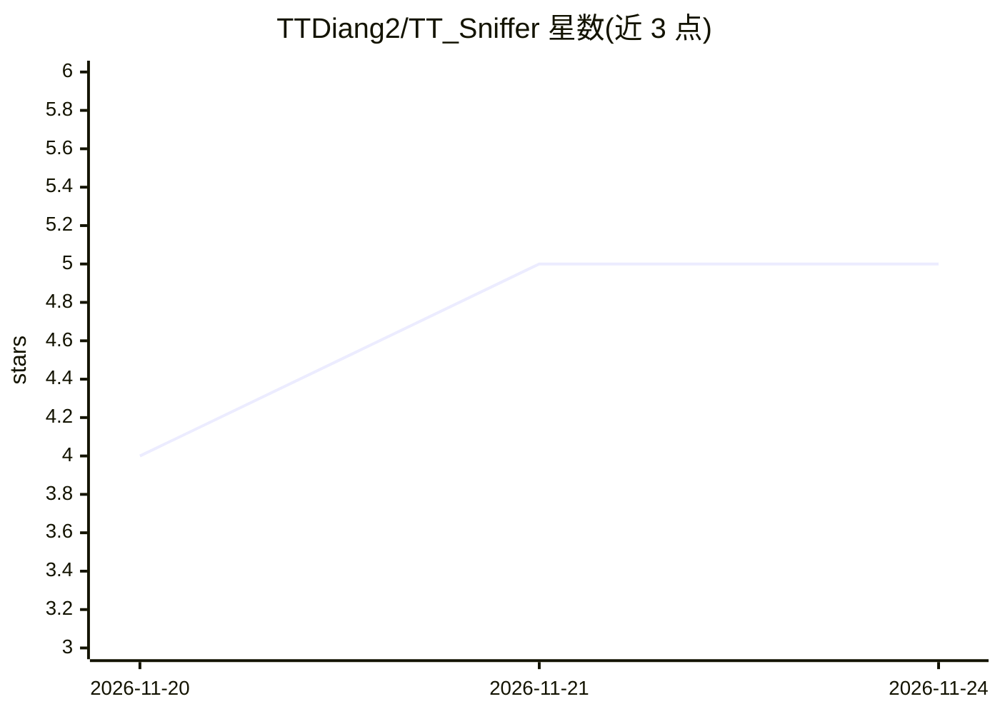

# TTDiang2/TT_Sniffer

⭐ 5 · Python · MIT · 推送 2026-10-24 · [GitHub](https://github.com/TTDiang2/TT_Sniffer) · 个人维护 · 中文 README

**A股/债券市场传闻的本地实时聚合情报台**

自托管的中文市场传闻（小作文）情报台：聚合财联社、股吧、Telegram 公开频道等 20+ 二级传播源，用两级传闻词表加市场相关性门槛做规则分类，跨源 SimHash 聚类同文，输出情绪、利率预期图表与推送。可选接入 OpenAI 兼容端点做翻译、锐评、摘要与传闻预筛。FastAPI + SQLite 单进程，前端预构建，仅采集公开渠道、不触碰私聊。

## 筛选速览

| 维度 | 判定 | 备注 |
|---|---|---|
| AI 角色 | `ai-native` | 本体是模型或模型工具 |
| 许可风险 | `permissive` | MIT |
| 部署形态 | `library` | 以包/库形式分发 |
| 模型依赖 | — | README 未给出锁定关系 |
| 硬件要求 | — | 无带数字的原话,不猜 |
| 安装摩擦 | `low` | 无编译、无系统依赖或容器化 |
| 成熟度 | — | 结构信号不足 |

## 能力要点

- 20+ 公开源聚合，30–60 秒轮询快讯线
- 规则引擎分类传闻 + SimHash 同文聚类与辟谣对撞
- 可选 LLM 三通道（翻译/锐评/聊天）含 key 池轮换与预算上限
- SSE 实时推送、可安装 PWA、移动端布局

## 适用场景

- 第一时间看到从股吧/Telegram 泄出的市场传闻
- 把传闻与官方快讯、辟谣声明对撞核验
- 按自选股和关键词接收企业微信/钉钉/飞书提醒

## 场景标签

`金融量化` · 领域:学习与行业

## 证据(README 行号)

> L11: It aggregates 20+ public sources into one local, real-time window, classifies
> L13: plots sentiment and rate expectations, and pushes alerts — all in a single

## 星数曲线

2026-11-20 4 → 2026-11-24 5（+1）

---
*卡片 v1 · prompt 1.4 · 生成 2026-11-21 · 置信度 high · 依据 README sha `01584bbf66bc` · [字段定义](../../DATASET.md)*
