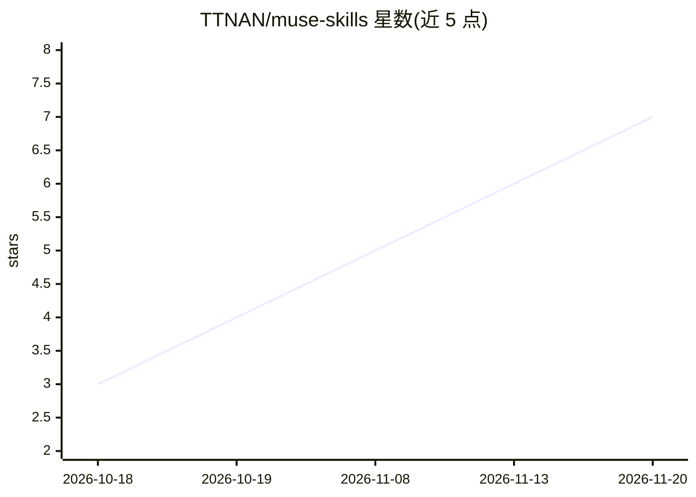

# TTNAN/muse-skills

⭐ — · [GitHub]() · 个人维护 · 中文 README

**面向 Muse 用户的 500 条中文实战技巧话术合集**

一份以 README 形式发布的 Muse 使用技巧清单，覆盖搞钱、金融投资、独立开发、效率、生活、购物、内容创作等 12 个场景共 500 条。每条由痛点描述、三句话术和一句边界说明（AI 搞不定的步骤）构成，用户通过搜索定位条目后把话术复制给 Muse 使用。Muse 是 Meta 的 AI 个人助理，可经授权读取邮箱、日历、健康数据、银行账单。README 附作者邀请码，内容按折叠列表组织。

## 筛选速览

| 维度 | 判定 | 备注 |
|---|---|---|
| AI 角色 | `ai-knowledge` | 知识聚合/清单类 |
| 许可风险 | `permissive` | — |
| 部署形态 | `None` |  |
| 模型依赖 | — | README 未给出锁定关系 |
| 硬件要求 | — | 无带数字的原话,不猜 |
| 安装摩擦 | `low` | 无编译、无系统依赖或容器化 |
| 成熟度 | — | 结构信号不足 |

## 能力要点

- 500 条技巧覆盖 12 大场景，每条含痛点、三句话术与边界说明
- 按场景分类组织（搞钱 60、投资 44、开发 48 等），支持 Ctrl+F 搜索定位
- 每条附「实话」说明 AI 无法代劳、需用户亲手完成的步骤

## 适用场景

- 想让 Muse 帮忙整理订阅、账单、报价单等日常琐事时查找对应话术
- 做副业接单、定价、对账时找现成的 AI 辅助流程
- 想了解 Muse 在各生活场景中能做与不能做的边界

## 场景标签

`精选清单` · 领域:学习与行业

## 证据(README 行号)

> L5: *500 个把 Muse 用出花的中文真招——专治各种"明明可以让 AI 干"的小麻烦。*
> L14: > 每招只干一件事：**说中你的痛**，**给你三句话术**，再附一句**实话**告诉你哪步它搞不定、必须亲手来。
> L41: **💰 搞钱与副业** 60 · **📈 金融与投资** 44 · **🛠️ 独立开发** 48 · **💼 工作与效率** 48 · **🏠 生活日常** 44 · **🛒 购物与省钱** 44 · **📣 内容创作与涨粉** 

## 星数曲线

2026-10-18 3 → 2026-11-20 7（+4）

---
*卡片 v1 · prompt 1.4 · 生成 2026-11-20 · 置信度 high · 依据 README sha `dad0a7e8f284` · [字段定义](../../DATASET.md)*
