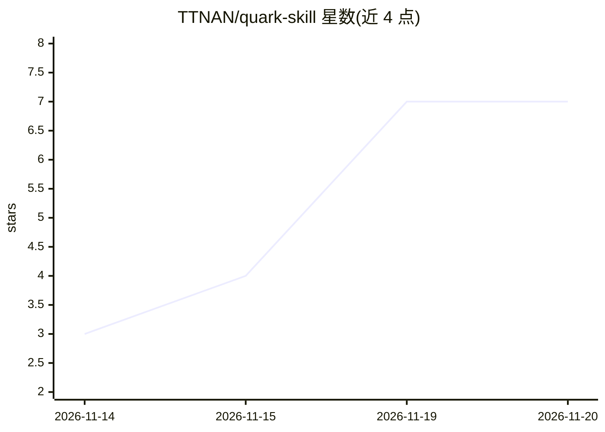

# TTNAN/quark-skill

⭐ 7 · Python · MIT · 推送 2026-11-19 · [GitHub](https://github.com/TTNAN/quark-skill) · 个人维护 · 中文 README

**让智能体一句话搜索并转存夸克网盘的 Agent Skill**

一个装在 Claude Code、Codex、Cursor 等智能体里的 Agent Skill：把用户的一句话转成 PanSou 聚合搜索（只留夸克链接、去重排序），逐条调夸克官方 share-detail 预检剔除失效链接，列出候选供用户挑选后调官方 saveas 转存，再用官方 search 回查落盘目录，并支持对存过的分享追更。脚本只用 Python 标准库，不抓 cookie、不逆向接口，官方夸克 Skill 在首次使用时经用户同意自动安装。仅支持夸克网盘，一次只转存一条分享。

## 筛选速览

| 维度 | 判定 | 备注 |
|---|---|---|
| AI 角色 | `ai-ecosystem` | LLM/agent 周边工具 |
| 许可风险 | `permissive` | MIT |
| 部署形态 | `desktop` | 安装包/桌面程序 |
| 模型依赖 | — | README 未给出锁定关系 |
| 硬件要求 | — | 无带数字的原话,不猜 |
| 安装摩擦 | `low` | 无编译、无系统依赖或容器化 |
| 成熟度 | — | 结构信号不足 |

## 能力要点

- PanSou 聚合搜索 + 夸克官方转存的两段式链路
- 官方 share-detail 预检剔除失效链接并附文件数与预览
- 不抓 cookie、不部署服务，脚本零第三方依赖
- 支持按文件筛选转存与已存分享的增量追更

## 适用场景

- 在智能体对话里直接搜课件、开源书并转存到夸克
- 连载或每周更新的资料存一次后自动查新增补存
- 替代手动搜链接、复制、粘贴、点保存的多窗口流程

## 场景标签

 · 领域:效率工具/网盘自动化

## 证据(README 行号)

> L4:  在 AI 智能体的对话里说一句「帮我存到夸克」，它会去搜、让你挑、自动转存、再回查确认。
> L29: 全程不抓 cookie、不逆向接口、不部署服务，只是把两段现成能力接起来：**PanSou 搜索 + 夸克官方转存**。
> L43: **适合**：在 Claude Code、Codex、Cursor 等智能体里工作、经常要存公开课件、开源书、教程资料的人。

## 星数曲线

2026-11-14 3 → 2026-11-20 7（+4）

---
*卡片 v1 · prompt 1.4 · 生成 2026-11-20 · 置信度 mid · 依据 README sha `f22f4283e0c0` · [字段定义](../../DATASET.md)*
