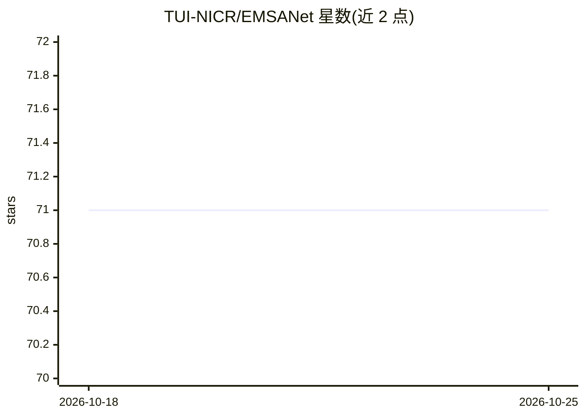

# TUI-NICR/EMSANet

⭐ 71 · Python · Apache-2.0 · 推送 2026-04-22 · [GitHub](https://github.com/TUI-NICR/EMSANet) · 组织维护

**RGB-D 室内场景多任务分割网络：全景分割+朝向估计+场景分类**

EMSANet 论文（IEEE Xplore/arXiv）的官方代码库，基于 PyTorch，在单网络中同时执行语义分割、实例分割（合成全景分割）、实例朝向估计与场景分类。提供训练、评估与推理脚本，以及导出 ONNX/TensorRT 和推理测时代码；在 NYUv2 与 SUNRGB-D 上提供 EMSANet-R34-NBt1D 预训练权重（含 Hypersim 预训练版本），并在 NVIDIA Jetson AGX Xavier 上报告 FPS。面向移动机器人等室内场景理解场景，以 git clone 源码 + conda 环境方式安装，需准备数据集方可复现训练/评估。

## 筛选速览

| 维度 | 判定 | 备注 |
|---|---|---|
| AI 角色 | `ai-native` | 本体是模型或模型工具 |
| 许可风险 | `permissive` | Apache-2.0 |
| 部署形态 | `library` | 以包/库形式分发 |
| 模型依赖 | — | README 未给出锁定关系 |
| 硬件要求 | — | 无带数字的原话,不猜 |
| 安装摩擦 | `medium` | 含编译或系统依赖之一 |
| 成熟度 | — | 结构信号不足 |

## 能力要点

- 单网络多任务输出：语义/实例/全景分割、实例朝向估计、场景分类
- 提供 ONNX 与 TensorRT 转换及推理测时代码，在 Jetson AGX Xavier 上报告 FPS
- NYUv2 / SUNRGB-D 预训练权重（含 Hypersim 预训练版本）可下载
- 2026 年更新环境（Python 3.12、PyTorch 2.10，支持 CUDA sm_70–sm_120 与 macOS MPS）

## 适用场景

- 室内移动机器人的实时 RGB-D 场景理解
- 在 NYUv2/SUNRGB-D 上复现论文多任务分割结果
- 将模型转为 ONNX/TensorRT 在嵌入式平台上测速部署

## 场景标签

`目标检测` · 领域:感知与多模态

## 证据(README 行号)

> L14: Our efficient multi-task approach for RGB-D scene analysis (EMSANet) simultaneously performs semantic and instance
> L15: segmentation (panoptic segmentation), instance orientation estimation, and scene classification.
> L19: This repository contains the code for training, evaluating, and applying our networks. Furthermore, we provide code

## 星数曲线

2026-10-18 71 → 2026-10-25 71（+0）

---
*卡片 v1 · prompt 1.4 · 生成 2026-10-24 · 置信度 mid · 依据 README sha `e22f4216ad53` · [字段定义](../../DATASET.md)*
