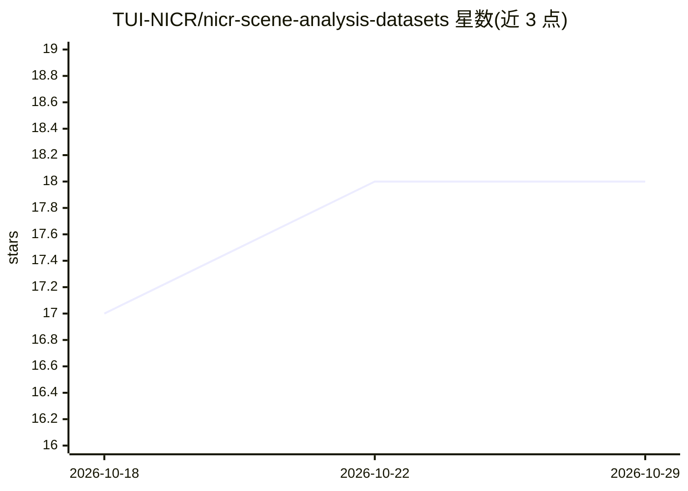

# TUI-NICR/nicr-scene-analysis-datasets

⭐ 18 · Python · Apache-2.0 · 推送 2026-06-18 · [GitHub](https://github.com/TUI-NICR/nicr-scene-analysis-datasets) · 组织维护

**面向场景分析的常见数据集准备与加载代码库**

提供 8 个常用场景分析数据集（ADE20k、COCO、Cityscapes、Hypersim、NYUv2、ScanNet、SceneNet RGB-D、SUNRGB-D）的准备脚本与统一 Python 加载接口，支持语义/实例分割、朝向估计、法线、3D 框等标注类型，并可生成合成深度、RGB 嵌入与全景嵌入等辅助数据。提供多个命令行入口点用于数据准备、标注点云生成与可视化，另有实验性的 Detectron2 注册接口与专用 DatasetMapper。代码以 Apache 2.0 发布，声明用于进行中的研究项目并按需维护。

## 筛选速览

| 维度 | 判定 | 备注 |
|---|---|---|
| AI 角色 | `ai-ecosystem` | LLM/agent 周边工具 |
| 许可风险 | `permissive` | Apache-2.0 |
| 部署形态 | `None` |  |
| 模型依赖 | — | README 未给出锁定关系 |
| 硬件要求 | — | 无带数字的原话,不猜 |
| 安装摩擦 | `low` | 无编译、无系统依赖或容器化 |
| 成熟度 | — | 结构信号不足 |

## 能力要点

- 8 个数据集的统一准备与加载接口，覆盖语义/实例/朝向/法线/3D 框等标注
- nicr_sa_generate_auxiliary_data 生成深度图、RGB 与全景嵌入等辅助数据
- 多个命令行入口点：数据准备、标注点云生成、三类可视化查看器
- 实验性 Detectron2 支持：DatasetCatalog 注册与专用/链式 DatasetMapper

## 适用场景

- 为语义/实例/全景分割研究准备标准化数据集
- 在自研训练管线中以 sample_keys 按需加载样本内容
- 在 Detectron2 训练流程中使用这些数据集
- 生成带标注的点云数据与各类辅助数据

## 场景标签

 · 领域:计算机视觉/数据集工程

## 证据(README 行号)

> L3: This repository contains code to prepare and use common datasets for scene analysis tasks.
> L27: > Note that for every dataset, starting with version 0.8.1 auxiliary data such as synthetic depth images, rgb image
> L83: ## Detectron2 usage (experimental support)

## 星数曲线

2026-10-18 17 → 2026-10-29 18（+1）

---
*卡片 v1 · prompt 1.4 · 生成 2026-10-29 · 置信度 high · 依据 README sha `29d5b2c9eb60` · [字段定义](../../DATASET.md)*
