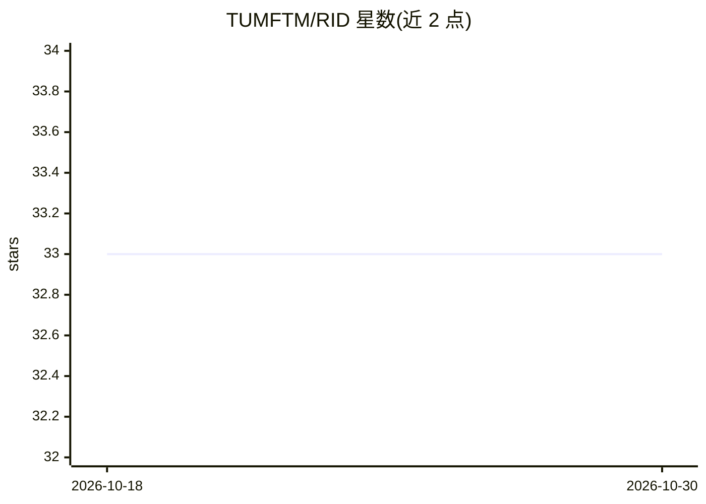

# TUMFTM/RID

⭐ 33 · Python · LGPL-3.0 · 推送 2026-08-24 · [GitHub](https://github.com/TUMFTM/RID) · 组织维护

**屋顶结构语义分割数据集与光伏潜力评估代码**

慕尼黑工业大学发表的屋顶信息数据集配套仓库：提供屋顶上层结构与屋顶分段两类语义分割标注数据（含五名标注员的标注实验及其评估），代码覆盖数据准备、掩膜生成、数据集分析、分割模型训练与评估，直至光伏潜力评估的完整流程。数据需从 DOI 链接另行下载，管线通过 main.py 运行，设置集中于 definitions.py，支持初始标签与复核标签两种输入。以 Python 3.6/3.7/3.9 编写，依赖 requirements.txt 中的包。

## 筛选速览

| 维度 | 判定 | 备注 |
|---|---|---|
| AI 角色 | `ai-knowledge` | 知识聚合/清单类 |
| 许可风险 | `viral` | LGPL-3.0 |
| 部署形态 | `None` |  |
| 模型依赖 | — | README 未给出锁定关系 |
| 硬件要求 | — | 无带数字的原话,不猜 |
| 安装摩擦 | `medium` | 含编译或系统依赖之一 |
| 成熟度 | — | 结构信号不足 |

## 能力要点

- 屋顶上层结构与屋顶分段两类语义分割数据集
- 含五名标注员标注实验的标签与评估
- main.py 七步管线：从矢量标签到光伏潜力评估
- 支持初始/复核两种标签质量的输入数据集

## 适用场景

- 训练屋顶结构语义分割模型
- 评估不同标注质量对分割结果的影响
- 基于航拍影像做建筑光伏潜力评估研究

## 场景标签

`目标检测` · 领域:感知与多模态

## 证据(README 行号)

> L4: This repository includes datasets for semantic segmentation of roof superstructures and roof roof segments. The code
> L2: This code refers to the publication "RID—Roof Information Dataset for Computer Vision-Based Photovoltaic Potential A

## 星数曲线

2026-10-18 33 → 2026-10-30 33（+0）

---
*卡片 v1 · prompt 1.4 · 生成 2026-10-25 · 置信度 high · 依据 README sha `23e439882d1f` · [字段定义](../../DATASET.md)*
