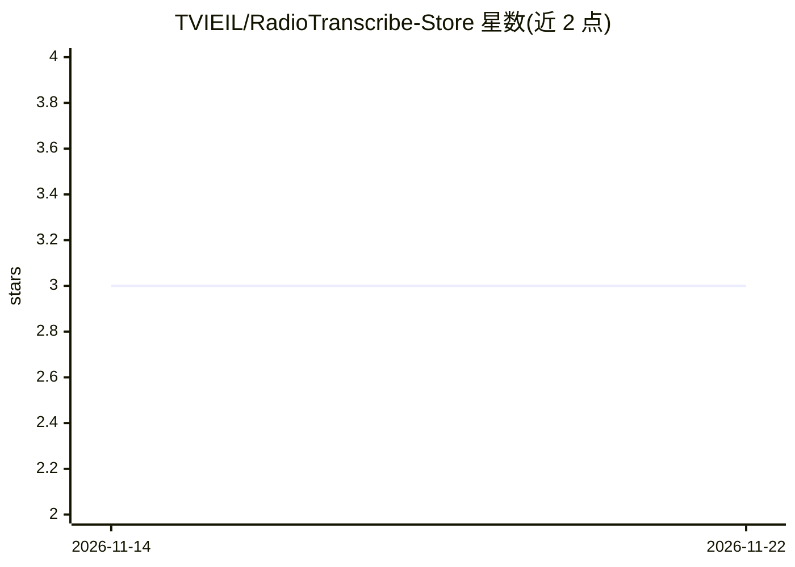

# TVIEIL/RadioTranscribe-Store

⭐ 3 · Python · MIT · 推送 2026-11-08 · [GitHub](https://github.com/TVIEIL/RadioTranscribe-Store) · 个人维护

**RTL-SDR 持续收听 FM 并实时转写归档的流水线**

将 RTL-SDR 软件无线电接收器变为持续的 FM 电波监听系统：被动接收 FM 直播流，用 Faster-Whisper 的 large-v3 模型实时将语音转为文本，过滤转写幻觉，并将数据写入 MariaDB 做秒级时间戳归档、写入 ChromaDB 做语义向量索引，支持自然语言查询新闻或离线供本地 LLM 做 RAG。提供一键安装与卸载脚本（含系统依赖、DVB 驱动黑名单、Conda 环境与 systemd 服务配置），面向 Linux 环境。

## 筛选速览

| 维度 | 判定 | 备注 |
|---|---|---|
| AI 角色 | `ai-native` | 本体是模型或模型工具 |
| 许可风险 | `permissive` | MIT |
| 部署形态 | `None` |  |
| 模型依赖 | — | README 未给出锁定关系 |
| 硬件要求 | — | 无带数字的原话,不猜 |
| 安装摩擦 | `low` | 无编译、无系统依赖或容器化 |
| 成熟度 | — | 结构信号不足 |

## 能力要点

- Faster-Whisper large-v3 模型实时 FM 语音转写并过滤幻觉
- MariaDB 关系库与 ChromaDB 向量库双重持久化索引
- ChromaDB 作为 RAG 记忆库，支持自然语言查询并可离线接本地 LLM
- 一键 install.sh 自动配置依赖、驱动黑名单与 systemd 服务

## 适用场景

- 持续监听并归档 FM 广播内容供检索
- 离线环境下用自然语言查询广播新闻
- 为本地 LLM 提供广播语料的 RAG 检索

## 场景标签

`RAG` `语音识别` · 领域:知识与检索

## 证据(README 行号)

> L5: > Pipeline autonome d'écoute radio continue (RTL-SDR), transcription automatique en temps réel (Faster-Whisper) et d
> L7: **RadioTranscribe-Store** transforme une simple clé logicielle SDR (*Software Defined Radio*) en sentinelle d'écoute

## 星数曲线

2026-11-14 3 → 2026-11-22 3（+0）

---
*卡片 v1 · prompt 1.4 · 生成 2026-11-22 · 置信度 high · 依据 README sha `ef4f8954b59d` · [字段定义](../../DATASET.md)*
