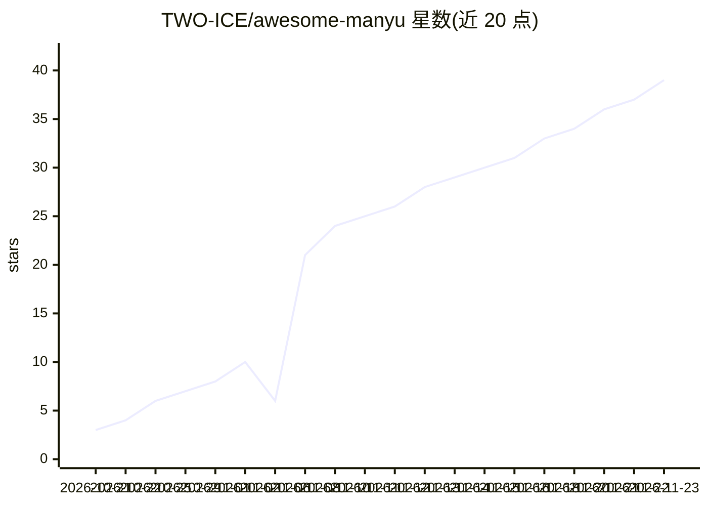

# TWO-ICE/awesome-manyu

⭐ 39 · Python · NOASSERTION · 推送 2026-11-16 · [GitHub](https://github.com/TWO-ICE/awesome-manyu) · 个人维护 · 中文 README

**开源 AI 漫剧/短剧工具清单：按生产流水线分类，含 License 红绿灯**

收录 97 个开源漫剧/AI 短剧相关项目的策展清单，按生产流水线组织：一站式平台、Claude Code 等 Agent 技能包（编剧/全流程/导演分镜/提示词库）、生图与角色一致性、视频生成模型速查、配音口型、漫画翻译、合成剪辑，另设网文改编参考链路专题。每个条目标注星数与 License 红绿灯（宽松/Copyleft/禁商用/无协议/疑似停止维护），数据由 GitHub Actions 每周自动刷新，README 表格由 scripts/refresh.py 从 data/projects.json 生成。仓库本身不托管代码，采用 CC0-1.0 许可。

## 筛选速览

| 维度 | 判定 | 备注 |
|---|---|---|
| AI 角色 | `ai-knowledge` | 知识聚合/清单类 |
| 许可风险 | `none` | NOASSERTION |
| 部署形态 | `None` |  |
| 模型依赖 | — | README 未给出锁定关系 |
| 硬件要求 | — | 无带数字的原话,不猜 |
| 安装摩擦 | `medium` | 含编译或系统依赖之一 |
| 成熟度 | — | 结构信号不足 |

## 能力要点

- 97 个项目按生产流水线分类组织
- License 红绿灯体系区分宽松/Copyleft/禁商用等状态
- 星数与 License 由 GitHub Actions 每周自动刷新
- 提供网文→漫剧的社区参考链路与技能/平台/模型分层导航

## 适用场景

- 找一句话出片或小说改编漫剧的一站式平台
- 为 Claude Code / Codex 等 Agent 挑选编剧与导演技能包
- 按显存与 License 挑选开源视频生成模型
- 确认某工具的商用许可风险

## 场景标签

`精选清单` · 领域:学习与行业

## 证据(README 行号)

> L3: # 🎬 Awesome 漫剧 · 开源 AI 漫剧 / AI 短剧工具集合
> L5: > 中文世界最全的开源漫剧工具地图：**按生产流水线分类 · License 红绿灯 · 数据每周自动刷新**
> L7: 📊 收录 **97** 个项目 ｜ 数据更新于 **2026-11-16** ｜ 由 GitHub Actions 每周自动刷新
> L210: - 本仓库只做链接与信息整理，不托管任何项目代码；

## 星数曲线

2026-10-21 3 → 2026-11-23 39（+36）

---
*卡片 v1 · prompt 1.4 · 生成 2026-11-18 · 置信度 mid · 依据 README sha `8e5e167a683e` · [字段定义](../../DATASET.md)*
