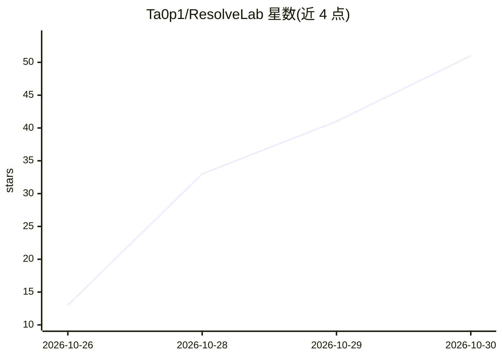

# Ta0p1/ResolveLab

⭐ 51 · Python · MIT · 推送 2026-10-29 · [GitHub](https://github.com/Ta0p1/ResolveLab) · 个人维护 · 中文 README

**注入故障的工具环境：评测并后训练 LLM agent 的恢复能力**

面向 agent 工程的实验环境：内置一个持久化 SQLite 同步服务和一个基于真实 HTTP 的票据服务，向其中注入故障，用于评测 agent 的故障恢复工作流并做小模型后训练（LoRA/BC/DAgger）。采用注册的 train/dev/test 划分、独立结果校验器与可重放审计脚本；策略端支持 Ollama 本地模型原生工具调用。服务与事件均为合成，作者声明不证明生产环境可靠性或向新工具的迁移。

## 筛选速览

| 维度 | 判定 | 备注 |
|---|---|---|
| AI 角色 | `ai-ecosystem` | LLM/agent 周边工具 |
| 许可风险 | `permissive` | MIT |
| 部署形态 | `None` |  |
| 模型依赖 | local-ok | 支持本地模型 |
| 硬件要求 | — | 无带数字的原话,不猜 |
| 安装摩擦 | `low` | 无编译、无系统依赖或容器化 |
| 成熟度 | — | 结构信号不足 |

## 能力要点

- 合成服务 + 故障注入 + 独立结果评分的评测环境
- 带注册 train/dev/test 划分与多种子的 LoRA/BC/DAgger 后训练管线
- 无 GPU 即可重放审计的验证脚本（verify_http_study 等）
- 支持 Ollama 本地模型原生工具调用，无隐藏规则回退

## 适用场景

- 评测 LLM agent 在故障场景下的恢复与升级决策能力
- 对 Qwen3 小模型做 BC/DAgger 后训练并配对评测
- 导出带溯源的 JSONL 轨迹做结果审计

## 场景标签

`模型评测` `微调` · 领域:评测与运维

## 证据(README 行号)

> L9: local-model tool use, independent outcome checks and small-model post-training with
> L173: resolvelab eval --seeds 42 73 101 --output artifacts/reference.json --require-policy reference
> L174: resolvelab eval --policies ollama --seeds 42 --output artifacts/local-model.json

## 星数曲线

2026-10-26 13 → 2026-10-30 51（+38）

---
*卡片 v1 · prompt 1.4 · 生成 2026-10-28 · 置信度 high · 依据 README sha `dd823733827a` · [字段定义](../../DATASET.md)*
