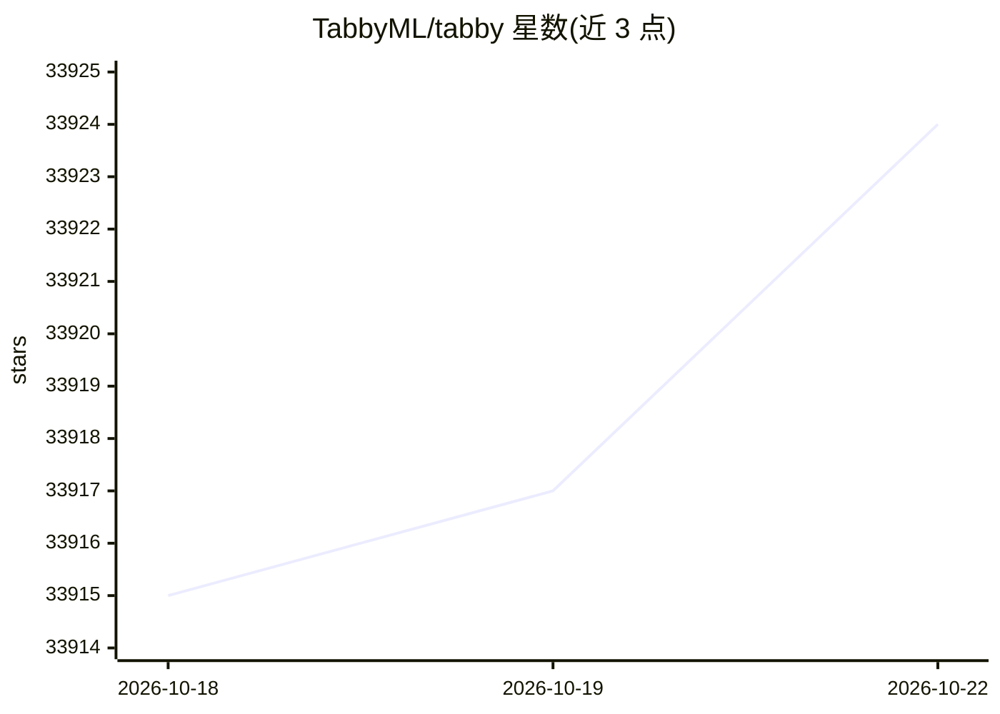

# TabbyML/tabby

⭐ 33,922 · Rust · NOASSERTION · 推送 2026-06-30 · [GitHub](https://github.com/TabbyML/tabby) · [官网](https://tabbyml.com) · 组织维护

**自托管 AI 编程助手：团队私有化部署代码补全与问答**

Tabby 是一个可自托管的开源 AI 编程助手，定位为 GitHub Copilot 的本地化部署替代方案。核心功能包括代码补全、聊天侧边栏、Answer Engine 知识问答；支持通过 REST API 接入自有文档、索引 GitLab Merge Request 作为上下文、LDAP 认证与团队管理。无需外部数据库或云服务，提供 Docker 一键启动方式，支持消费级 GPU；另可从 Rust 源码构建。IDE 侧通过 VSCode/Vim/IntelliJ 插件接入。

## 筛选速览

| 维度 | 判定 | 备注 |
|---|---|---|
| AI 角色 | `ai-native` | 本体是模型或模型工具 |
| 许可风险 | `none` | NOASSERTION |
| 部署形态 | `self-host` | docker 或自建部署 |
| 模型依赖 | — | README 未给出锁定关系 |
| 硬件要求 | — | 无带数字的原话,不猜 |
| 安装摩擦 | `low` | 无编译、无系统依赖或容器化 |
| 成熟度 | — | 结构信号不足 |

## 动量与使用信号

- 维护:`maintenance` — 距上次 push 109.5 天,年发版 4,117 位贡献者
- 涨星:近 1 天 **-1**(自 20261016 起算)

## 能力要点

- 自包含部署，无需 DBMS 或云服务
- 支持消费级 GPU 及 Apple M1/M2 Metal 推理
- 提供 OpenAPI 接口与 VSCode/Vim/IntelliJ 插件
- RAG 代码补全、Answer Engine 与 GitLab MR 索引

## 适用场景

- 团队私有化部署代码补全与 AI 问答服务
- 接入内部文档和代码仓库构建工程知识引擎
- 在无外部云依赖的环境下为 IDE 提供补全

## 场景标签

`代码生成` `RAG` `聊天机器人` · 领域:编码与开发

## 证据(README 行号)

> L14: Tabby is a self-hosted AI coding assistant, offering an open-source and on-premises alternative to GitHub Copilot. 
> L15: * Self-contained, with no need for a DBMS or cloud service.
> L17: * Supports consumer-grade GPUs.

## 星数曲线

2026-10-18 33,915 → 2026-10-22 33,924（+9）

---
*卡片 v1 · prompt 1.4 · 生成 2026-10-18 · 置信度 high · 依据 README sha `d1805ddf16da` · [字段定义](../../DATASET.md)*
