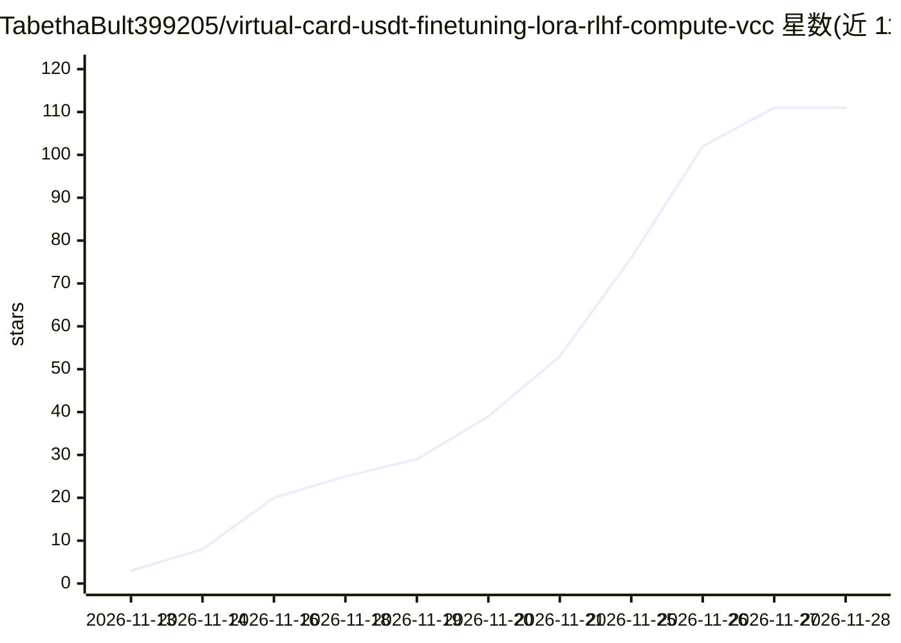

# TabethaBult399205/virtual-card-usdt-finetuning-lora-rlhf-compute-vcc

⭐ 111 · 推送 2026-11-13 · [GitHub](https://github.com/TabethaBult399205/virtual-card-usdt-finetuning-lora-rlhf-compute-vcc) · [官网](https://app.coregold.io/signup?invite_code=ADvlj9b) · 组织维护 · 中文 README

**推广 CoreGold 虚拟卡+USDT 为 AI 训练算力付费设预算上限**

这不是软件项目，而是 CoreGold 虚拟卡（VCC）服务的推广文档：面向租用海外 GPU 集群做 LoRA/SFT/RLHF 微调的团队，陈述按秒计费失控、绑卡风控拦截、跨国购汇核算三类结算痛点，主张用 USDT 充值签发单次实验专用商业 VCC，以硬限额在清算层实现预算熔断。文档给出开卡、绑卡、训练后销卡的流程说明，末尾放置控制台入口与一串十六进制字符串，无任何代码、安装或运行内容。

## 筛选速览

| 维度 | 判定 | 备注 |
|---|---|---|
| AI 角色 | `ai-enhanced` | 去掉 AI 部分产品仍成立 |
| 许可风险 | `none` | — |
| 部署形态 | `None` |  |
| 模型依赖 | — | README 未给出锁定关系 |
| 硬件要求 | — | 无带数字的原话,不猜 |
| 安装摩擦 | `low` | 无编译、无系统依赖或容器化 |
| 成熟度 | — | 结构信号不足 |

## 能力要点

- 以单卡消费硬限额实现训练任务预算熔断的方案陈述
- USDT（TRC20/ERC20）充值兑换 USD 并按实验划拨的流程
- 面向 RunPod / Lambda Labs 等算力平台的绑卡与 AVS 验资说明

## 适用场景

- 为单次微调实验设定算力消费上限
- 海外 GPU 平台绑卡与验资场景的支付参考
- 训练结束后回收未消耗预算

## 场景标签

 · 领域:支付/金融服务

## 证据(README 行号)

> L2: 针对开源大模型私有化微调（LoRA / SFT / DPO 强化学习）与分布式评估集群计费痛点，剖析云端按秒计费实例失控与跨国验资拦截难题，通过 CoreGold 商业虚拟卡（VCC）+ USDT 构建训练级预算断路器。
> L7: 然而，模型训练是典型的“高密度重资产吞金兽”——一组 8 卡 H100 实例每小时算力租金高达数十美元。如果在分布式训练脚本中出现梯度爆炸导致无效空转、Checkpoint 保存卡死，或者工程师在凌晨结束实验后忘记执行集群销毁指令，
> L42: 👉 **立即进入 CoreGold 官方开卡控制台**

## 星数曲线

2026-11-13 3 → 2026-11-28 111（+108）

---
*卡片 v1 · prompt 1.4 · 生成 2026-11-18 · 置信度 low · 依据 README sha `1277de3900bc` · [字段定义](../../DATASET.md)*
