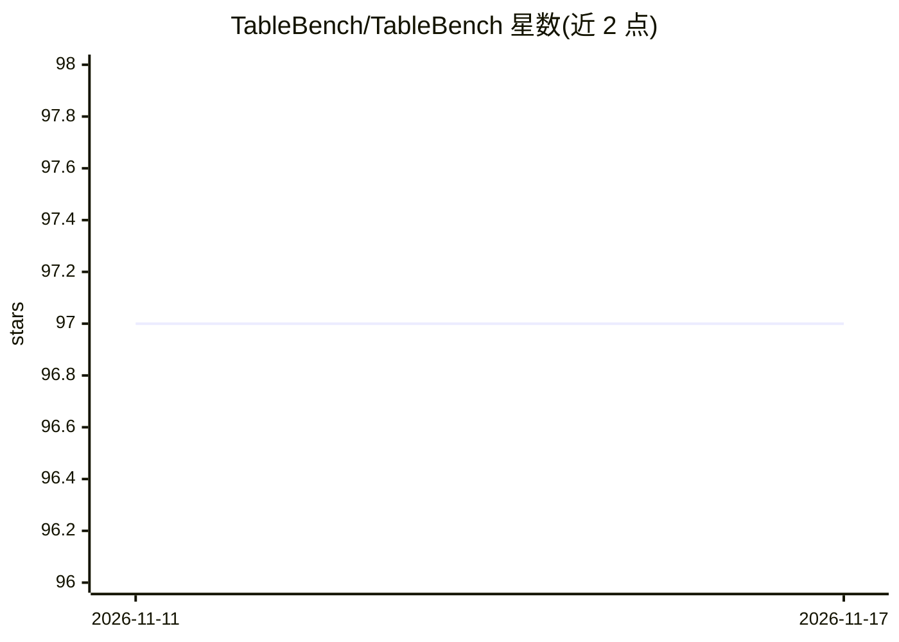

# TableBench/TableBench

⭐ 97 · Python · 推送 2026-11-11 · [GitHub](https://github.com/TableBench/TableBench) · [官网](https://tablebench.github.io/) · 组织维护

**面向研究者的表格问答基准数据集与评测脚本（886 案例，18 类）**

AAAI 2025 论文 TableBench 的官方仓库：提供覆盖事实核查、数值推理、数据分析与可视化 4 大类 18 个问题类别的 886 个测试案例的表格问答基准数据集（经 Hugging Face 分发，2025 年 4 月发布修订版），并附带答案解析脚本与评测脚本，指标包括 EM、带 ±10% 误差的 EM、ROUGE-L 与 Pass@1 等。评测流程为：下载数据集→用自有 LLM 生成预测→解析最终答案→运行评测脚本输出 json/csv 结果。面向从事 LLM 表格问答能力评估的研究者与开发者，另维护在线 Leaderboard 接受提交。

## 筛选速览

| 维度 | 判定 | 备注 |
|---|---|---|
| AI 角色 | `ai-knowledge` | 知识聚合/清单类 |
| 许可风险 | `none` | — |
| 部署形态 | `None` |  |
| 模型依赖 | — | README 未给出锁定关系 |
| 硬件要求 | — | 无带数字的原话,不猜 |
| 安装摩擦 | `low` | 无编译、无系统依赖或容器化 |
| 成熟度 | — | 结构信号不足 |

## 能力要点

- 886 个测试案例，覆盖 4 大类 18 个问题类别
- 提供解析脚本与评测脚本，输出 json/csv 格式结果
- 分任务定义指标：EM、EM_with_error_10、ROUGE-L、Pass@1
- 附带 parse@1 / ecr@1 / pass@1 等术语定义与示例推理结果文件

## 适用场景

- 评估自有 LLM 在表格问答任务上的表现并提交排行榜
- 复现论文中不同模型的表格问答评测结果
- 对比模型在事实核查与数值推理等子任务上的能力

## 场景标签

`模型评测` · 领域:评测与运维

## 证据(README 行号)

> L39: <code style="color:#8b44c7"> TableBench </code> is a comprehensive and complex
> L45:  Analysis , and Visualization —with 886 carefully curated test cases. TableBench

## 星数曲线

2026-11-11 97 → 2026-11-17 97（+0）

---
*卡片 v1 · prompt 1.4 · 生成 2026-11-17 · 置信度 high · 依据 README sha `f035262bca5f` · [字段定义](../../DATASET.md)*
