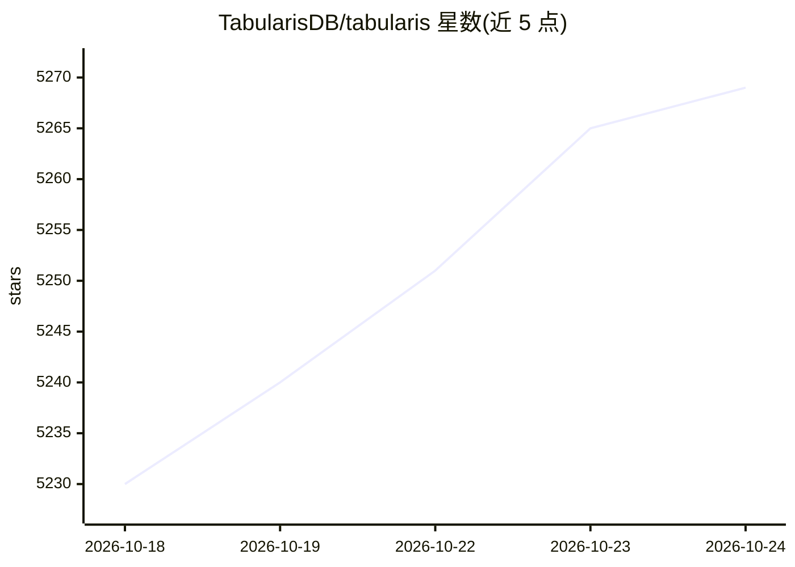

# TabularisDB/tabularis

⭐ 5,269 · TypeScript · Apache-2.0 · 推送 2026-10-23 · [GitHub](https://github.com/TabularisDB/tabularis) · [官网](https://tabularis.dev) · 组织维护 · 中文 README

**开源桌面 SQL 工作台，内置 MCP 服务器供 AI agent 使用**

跨平台桌面 SQL 客户端：内置 PostgreSQL/MySQL/MariaDB/SQLite 三种驱动，另通过 JSON-RPC 插件系统提供 24 个官方驱动插件（DuckDB、ClickHouse、Redis、SQL Server、MongoDB 等，任意语言可写）。面向开发者与数据分析师，功能含 Monaco SQL 编辑器、SQL+Markdown 笔记本、可视化查询构建器、交互式 EXPLAIN 计划图、ER 图、数据网格与插件注册表。AI 为附加能力：内置 MCP 服务器让 Claude/Cursor/Devin 读取 schema 并执行查询，编辑器含 AI 助手层与本地模型（Ollama）text-to-SQL。提供 WinGet/Homebrew/Snap/Flatpak/AUR 安装。

## 筛选速览

| 维度 | 判定 | 备注 |
|---|---|---|
| AI 角色 | `ai-enhanced` | 去掉 AI 部分产品仍成立 |
| 许可风险 | `permissive` | Apache-2.0 |
| 部署形态 | `desktop` | 安装包/桌面程序 |
| 模型依赖 | local-ok | 支持本地模型 |
| 硬件要求 | — | 无带数字的原话,不猜 |
| 安装摩擦 | `low` | 无编译、无系统依赖或容器化 |
| 成熟度 | `idea` | |

## 能力要点

- 内置 MCP 服务器，供 Claude/Cursor/Devin 读取 schema 并运行查询
- 3 个内置驱动 + 24 个官方插件，插件可用任意语言经 JSON-RPC 2.0 编写
- SQL 笔记本支持跨单元格变量（{{cell_N}}）与图表，可导出 HTML/CSV/JSON
- Visual EXPLAIN 以交互节点图呈现执行计划，含 AI 分析视图

## 适用场景

- 在桌面端统一连接和管理多种数据库并编写 SQL
- 让 Claude/Cursor 等 AI agent 通过 MCP 直接查询我的数据库
- 用 SQL+Markdown 笔记本做数据探索并生成图表
- 通过插件系统为 DuckDB、Redis 等数据库添加支持

## 场景标签

`数据分析` · 领域:效率与自动化

## 证据(README 行号)

> L6: Tabularis is an open-source desktop SQL workspace with 3 built-in database drivers and 24 shipped plugins, including
> L70: |Built-in MCP server for AI agents|✅|❌|❌|❌|
> L72: |AI text-to-SQL with **local models** (Ollama)|✅|Cloud-based AI assistant|❌|❌|

## 星数曲线

2026-10-18 5,230 → 2026-10-24 5,269（+39）

---
*卡片 v1 · prompt 1.4 · 生成 2026-10-20 · 置信度 mid · 依据 README sha `2fe43df32323` · [字段定义](../../DATASET.md)*
