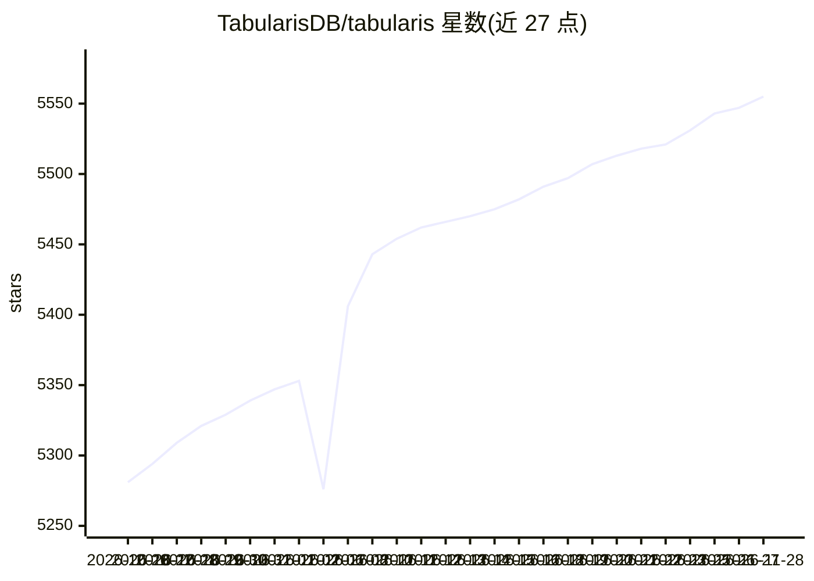

# TabularisDB/tabularis

⭐ 5,555 · TypeScript · Apache-2.0 · 推送 2026-11-27 · [GitHub](https://github.com/TabularisDB/tabularis) · [官网](https://tabularis.dev) · 组织维护

**面向开发者的开源桌面 SQL 工作台，内置 MCP 服务器供 AI agent 查库**

基于 Tauri 生态的跨平台桌面 SQL 客户端：内置 PostgreSQL、MySQL/MariaDB、SQLite 三种驱动，另通过 JSON-RPC 插件系统提供约 30 个驱动插件（DuckDB、ClickHouse、Redis、MongoDB 等），插件可用任意语言编写。AI 相关功能包括供 Claude、Cursor、Devin 读取 schema 与执行查询的内置 MCP 服务器、基于 Ollama 本地模型的 text-to-SQL、AI assist 覆盖层与 AI 生成的 notebook 单元命名。通过 WinGet/brew/Snap/Flatpak/AppImage/AUR 分发，UI 提供 13 种语言。

## 筛选速览

| 维度 | 判定 | 备注 |
|---|---|---|
| AI 角色 | `ai-enhanced` | 去掉 AI 部分产品仍成立 |
| 许可风险 | `permissive` | Apache-2.0 |
| 部署形态 | `desktop` | 安装包/桌面程序 |
| 模型依赖 | local-ok | 支持本地模型 |
| 硬件要求 | — | 无带数字的原话,不猜 |
| 安装摩擦 | `low` | 无编译、无系统依赖或容器化 |
| 成熟度 | — | 结构信号不足 |

## 能力要点

- 内置 MCP 服务器，供 Claude、Cursor、Devin 读取 schema 并执行查询
- 基于 Ollama 本地模型的 AI text-to-SQL（L73）
- JSON-RPC over stdio 插件系统，驱动可用任意语言编写
- SQL notebooks 支持跨单元格变量、图表与 HTML/CSV/JSON 导出

## 适用场景

- 在统一桌面客户端连接并管理多种数据库（含 ClickHouse、Redis、MongoDB 等）
- 让 Claude/Cursor 等 AI agent 通过 MCP 读取数据库结构并运行查询
- 用 SQL notebook 组合 SQL 与 Markdown 单元格做数据分析
- 用可视化 EXPLAIN 与 ER 图检查执行计划和表结构

## 场景标签

`数据分析` · 领域:效率与自动化

## 证据(README 行号)

> L6: Tabularis is an open-source desktop SQL workspace with 3 built-in database drivers and 30 shipped driver plugins, in
> L71: |Built-in MCP server for AI agents|✅|❌|❌|❌|
> L73: |AI text-to-SQL with **local models** (Ollama)|✅|Cloud-based AI assistant|❌|❌|

## 星数曲线

2026-10-26 5,281 → 2026-11-28 5,555（+274）

---
*卡片 v1 · prompt 1.4 · 生成 2026-11-27 · 置信度 mid · 依据 README sha `42b88a4e8df1` · [字段定义](../../DATASET.md)*
