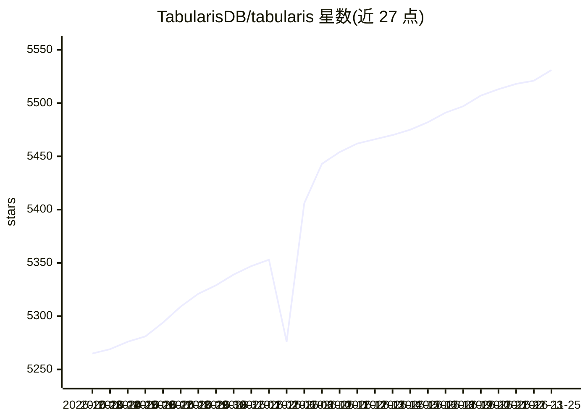

# TabularisDB/tabularis

⭐ 5,531 · TypeScript · Apache-2.0 · 推送 2026-11-23 · [GitHub](https://github.com/TabularisDB/tabularis) · [官网](https://tabularis.dev) · 组织维护 · 中文 README

**给开发者用的开源桌面 SQL 工作台，内置 MCP 供 AI agent 读库执行查询**

开源桌面 SQL 工作区：内置 PostgreSQL、MySQL/MariaDB、SQLite 驱动，另通过 JSON-RPC stdio 插件系统提供 30 个驱动插件（DuckDB、ClickHouse、Redis、SQL Server、Oracle 等）。功能覆盖连接管理（SSH 隧道、Keychain 密码存储）、ER 图、Monaco 编辑器、SQL Notebook（跨单元格变量、图表）、可视化查询构建器与 Visual EXPLAIN。AI 相关机制：内置 MCP server 供 Claude/Cursor/Devin 读取 schema 并执行查询，支持基于 Ollama 本地模型的 text-to-SQL 与 AI 辅助分析。提供 WinGet/brew/snap/Flatpak/AppImage/AUR 等安装途径。

## 筛选速览

| 维度 | 判定 | 备注 |
|---|---|---|
| AI 角色 | `ai-enhanced` | 去掉 AI 部分产品仍成立 |
| 许可风险 | `permissive` | Apache-2.0 |
| 部署形态 | `desktop` | 安装包/桌面程序 |
| 模型依赖 | local-ok | 支持本地模型 |
| 硬件要求 | — | 无带数字的原话,不猜 |
| 安装摩擦 | `low` | 无编译、无系统依赖或容器化 |
| 成熟度 | — | 结构信号不足 |

## 能力要点

- 内置 MCP server，AI agent 可读取 schema 并执行查询
- 3 内置驱动 + 30 个插件驱动，插件可用任意语言经 JSON-RPC 编写
- SQL Notebook 支持 SQL+Markdown 单元格、跨单元格变量与图表
- Visual EXPLAIN 以交互式计划图展示执行计划

## 适用场景

- 统一连接多种数据库进行查询与数据编辑
- 通过 SQL Notebook 做带参数与图表的数据分析
- 让 Claude/Cursor 等 AI agent 直接操作数据库
- 通过插件为小众数据库接入 GUI 支持

## 场景标签

`数据分析` · 领域:效率与自动化

## 证据(README 行号)

> L6: Tabularis is an open-source desktop SQL workspace with 3 built-in database drivers and 30 shipped driver plugins, in
> L71: |Built-in MCP server for AI agents|✅|❌|❌|❌|
> L73: |AI text-to-SQL with **local models** (Ollama)|✅|Cloud-based AI assistant|❌|❌|

## 星数曲线

2026-10-23 5,265 → 2026-11-25 5,531（+266）

---
*卡片 v1 · prompt 1.4 · 生成 2026-11-24 · 置信度 mid · 依据 README sha `76502fa303b5` · [字段定义](../../DATASET.md)*
