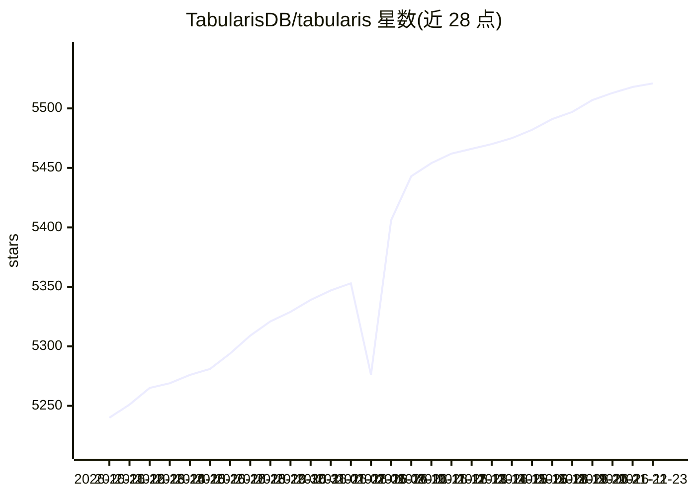

# TabularisDB/tabularis

⭐ 5,521 · TypeScript · Apache-2.0 · 推送 2026-11-22 · [GitHub](https://github.com/TabularisDB/tabularis) · [官网](https://tabularis.dev) · 组织维护

**开源桌面 SQL 工作台：连接多数据库并提供内置 MCP 服务器与 AI 功能**

基于 Tauri/桌面打包的 SQL 工作台，内置 PostgreSQL、MySQL/MariaDB、SQLite 三种驱动，其余数据库通过 JSON-RPC over stdio 的外置插件接入（README 列出 30 个已发布插件，含 SQL Server、DuckDB、ClickHouse、Redis、MongoDB 等）。功能包括连接管理（SSH 隧道、Keychain 密码存储）、ER 图、Monaco 编辑器、SQL Notebook（SQL+Markdown 单元格、跨单元格变量与图表）、可视化查询构建器与可视化 EXPLAIN。内置 MCP 服务器供 Claude、Cursor、Devin 读取 schema 并执行查询；AI text-to-SQL 可接本地模型（Ollama）。提供 Windows/macOS/Linux 多渠道安装。

## 筛选速览

| 维度 | 判定 | 备注 |
|---|---|---|
| AI 角色 | `ai-enhanced` | 去掉 AI 部分产品仍成立 |
| 许可风险 | `permissive` | Apache-2.0 |
| 部署形态 | `desktop` | 安装包/桌面程序 |
| 模型依赖 | local-ok | 支持本地模型 |
| 硬件要求 | — | 无带数字的原话,不猜 |
| 安装摩擦 | `low` | 无编译、无系统依赖或容器化 |
| 成熟度 | — | 结构信号不足 |

## 能力要点

- 内置 MCP 服务器，供 Claude/Cursor/Devin 读取 schema 并运行查询
- 3 个内置驱动 + 30 个驱动插件，插件可用任意语言编写（JSON-RPC 2.0）
- SQL Notebook：SQL+Markdown 单元格、跨单元格变量、内嵌图表
- AI text-to-SQL 支持本地模型（Ollama）与可视化 EXPLAIN 计划图

## 适用场景

- 用统一桌面客户端管理 MySQL/PostgreSQL/SQLite 及插件数据库连接
- 在 Notebook 中混合编写 SQL 与 Markdown 并生成图表
- 让 Claude/Cursor 等 AI 工具通过 MCP 读取库结构并执行查询
- 以交互式计划图分析查询执行计划

## 场景标签

`数据分析` · 领域:效率与自动化

## 证据(README 行号)

> L6: Tabularis is an open-source desktop SQL workspace with 3 built-in database drivers and 30 shipped driver plugins, in
> L283: Tabularis is **hackable with an external plugin system**. Plugins are standalone executables that communicate with

## 星数曲线

2026-10-21 5,240 → 2026-11-23 5,521（+281）

---
*卡片 v1 · prompt 1.4 · 生成 2026-11-22 · 置信度 mid · 依据 README sha `2567d1b2f916` · [字段定义](../../DATASET.md)*
