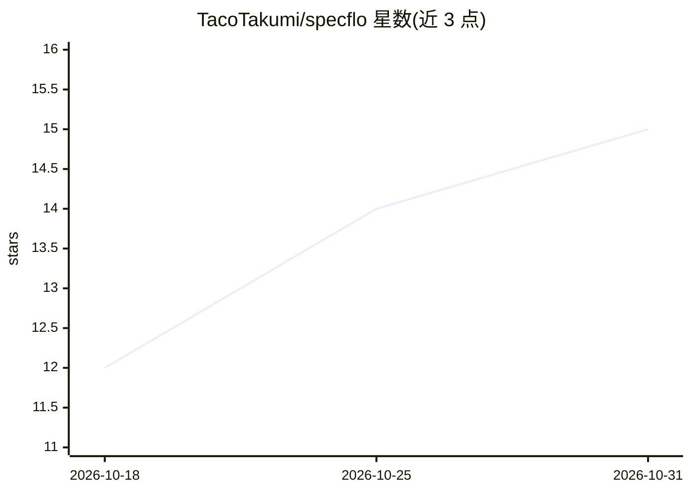

# TacoTakumi/specflo

⭐ 15 · Python · NOASSERTION · 推送 2026-10-24 · [GitHub](https://github.com/TacoTakumi/specflo) · [官网](https://tacotakumi.github.io/specflo/) · 个人维护

**给 AI 编码 agent 的规范驱动开发 CLI：脑暴→规范→计划→执行**

Python CLI 加一组 skills 与 hooks，为 AI 编码 agent 提供纪律化的 brainstorm→spec→plan→执行四阶段流水线：阶段状态、验证门与单任务聚焦存放在磁盘上的 markdown 工件而非模型上下文中，便于与较小本地模型（如 Qwen3.6 27B）协作。支持多项目并行、checkpoint 断点恢复、编号化评审回合（blocker/should-fix/nit 分级），并内置 quick/fast/full/harden/research 五级流程。Claude Code 与 pi 开箱集成，opencode 与 Hermes 提供 skills，其他 harness 可通过纯 CLI 驱动。Pre-1.0 接口可能变动；pi 子代理、daemon 与 agent pool 三处为持续变动的在建面。

## 筛选速览

| 维度 | 判定 | 备注 |
|---|---|---|
| AI 角色 | `ai-ecosystem` | LLM/agent 周边工具 |
| 许可风险 | `viral` | NOASSERTION |
| 部署形态 | `library` | 以包/库形式分发 |
| 模型依赖 | — | README 未给出锁定关系 |
| 硬件要求 | — | 无带数字的原话,不猜 |
| 安装摩擦 | `low` | 无编译、无系统依赖或容器化 |
| 成熟度 | `idea` | |

## 能力要点

- 四阶段流水线，阶段工件为磁盘 markdown（决策 D-NN/需求 REQ-NN/任务 T-NN/里程碑 M-NN）
- specflo advance 阶段验证门，评审回合带分级 findings 与回归标记
- 五种项目级别：quick/fast/full/harden/research
- Claude Code、pi 开箱集成；skills 兼容 opencode、Hermes，任意可跑 CLI 的 harness 可驱动

## 适用场景

- 让编码 agent 按规范驱动流程开发功能，工件落盘可审计
- 用本地小模型做有纪律的多阶段开发
- 在一个 monorepo 里并行推进多个开发/研究项目
- 对已完成的分支执行带 findings 记录的代码评审

## 场景标签

`编码 Agent` `代码审查` · 领域:编码与开发

## 证据(README 行号)

> L7: **Spec-driven software engineering for coding agents.** specflo is a Python CLI
> L8: plus a set of skills and hooks that give an AI agent a disciplined
> L23: - **Pluggable into any harness that can run a CLI and read markdown.** Claude

## 星数曲线

2026-10-18 12 → 2026-10-31 15（+3）

---
*卡片 v1 · prompt 1.4 · 生成 2026-10-31 · 置信度 high · 依据 README sha `73b18fe18942` · [字段定义](../../DATASET.md)*
