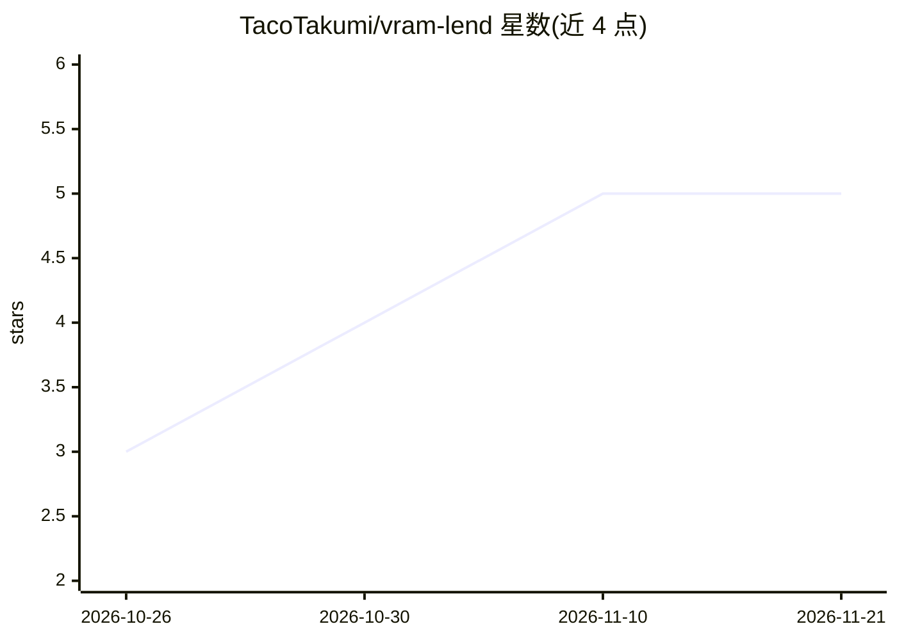

# TacoTakumi/vram-lend

⭐ 5 · Python · MIT · 推送 2026-11-20 · [GitHub](https://github.com/TacoTakumi/vram-lend) · 个人维护

**让推理引擎临时出借 GPU 显存的命令行与协议工具**

VRAM Lend 提供 HTTP API（/vram/lend、/vram/return、/vram/state）与同名 CLI，使推理引擎在持续服务请求的同时，把 GPU 上的 MoE expert cache 释放给同机其他程序短期使用，租约结束后归还显存。支持 Project Maya、Strata、llama.cpp 三个引擎的 fork 分支，并可通过 llama-swap 统一入口路由到各引擎。附带的 agent skill 安装到 Claude Code、pi、Hermes、opencode 等 harness。项目含基准测试数据与协议/实现文档。

## 筛选速览

| 维度 | 判定 | 备注 |
|---|---|---|
| AI 角色 | `ai-ecosystem` | LLM/agent 周边工具 |
| 许可风险 | `permissive` | MIT |
| 部署形态 | `library` | 以包/库形式分发 |
| 模型依赖 | — | README 未给出锁定关系 |
| 硬件要求 | — | 无带数字的原话,不猜 |
| 安装摩擦 | `medium` | 含编译或系统依赖之一 |
| 成熟度 | — | 结构信号不足 |

## 能力要点

- HTTP API 出借/归还/查询 GPU 显存租约，引擎不中断服务
- pipx 安装的 Python CLI，单文件无第三方依赖
- skill 安装器分发到 Claude Code/pi/Hermes/opencode 的用户技能目录
- 附三引擎 fork 分支的基准测试结果与协议设计文档

## 适用场景

- 在已部署大模型服务的机器上临时运行 Android 模拟器、语音或图像服务
- agent 在不停止模型的前提下为短任务申请 GPU 显存
- 通过 llama-swap 单一地址管理多引擎的显存租约

## 场景标签

 · 领域:LLM 基础设施/推理运行时

## 证据(README 行号)

> L3: VRAM Lend lets an inference engine lend part of its GPU memory to another
> L102: An agent that needs GPU memory for a short job on a machine where a model is
> L111: pipx install vram-lend          # or: pip install vram-lend

## 星数曲线

2026-10-26 3 → 2026-11-21 5（+2）

---
*卡片 v1 · prompt 1.4 · 生成 2026-11-21 · 置信度 high · 依据 README sha `3aa72e0bd2e2` · [字段定义](../../DATASET.md)*
