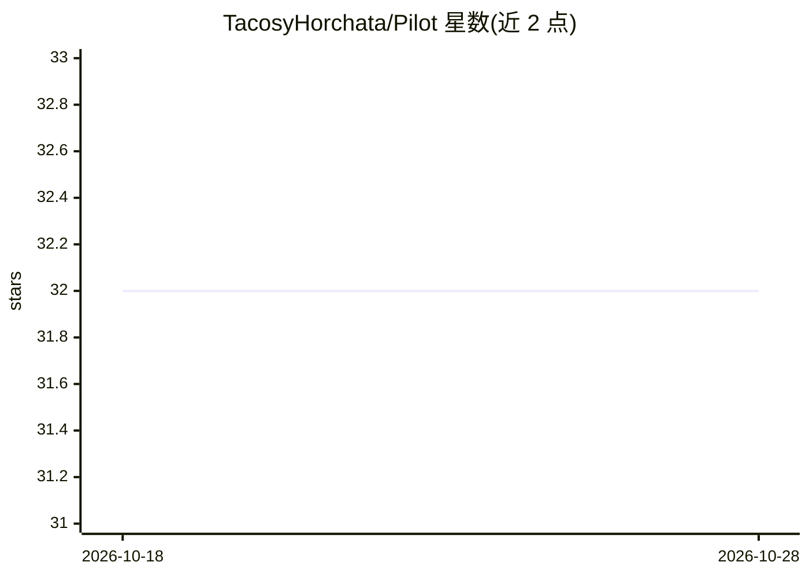

# TacosyHorchata/Pilot

⭐ 32 · TypeScript · MIT · 推送 2026-06-28 · [GitHub](https://github.com/TacosyHorchata/Pilot) · 个人维护

**供 AI agent 控制真实浏览器的 MCP 服务器**

Pilot 是一个浏览器自动化 MCP 服务器，供 Claude Code、Cursor 等 MCP 客户端通过 stdio 连接并驱动浏览器。默认原生模式使用 Playwright 隔离浏览器上下文，截图不依赖 Chrome 前台；旧版扩展模式可接入已登录的真实 Chrome 配置（支持 Chrome/Arc/Brave/Edge/Comet cookie 导入）。通过三档工具配置（core 9 个/standard 40 个/full 69 个）控制暴露给 LLM 的工具数量，navigate 快照约 2K 字符并提供 snapshot_diff 仅展示变更。要求 Node.js>=18、Playwright Chromium、macOS 或 Linux。

## 筛选速览

| 维度 | 判定 | 备注 |
|---|---|---|
| AI 角色 | `ai-ecosystem` | LLM/agent 周边工具 |
| 许可风险 | `permissive` | MIT |
| 部署形态 | `library` | 以包/库形式分发 |
| 模型依赖 | — | README 未给出锁定关系 |
| 硬件要求 | — | 无带数字的原话,不猜 |
| 安装摩擦 | `low` | 无编译、无系统依赖或容器化 |
| 成熟度 | `idea` | |

## 能力要点

- 默认 Playwright 隔离上下文的原生模式，截图不依赖 Chrome 前台
- core/standard/full 三档工具配置，共 69 个工具
- lean snapshot（~2K navigate）与 snapshot_diff 只返回变更内容
- 扩展模式可复用已登录真实 Chrome 配置，支持 5 种浏览器 cookie 导入

## 适用场景

- 让 AI agent 在已登录的真实浏览器中执行操作
- QA 自动化：并行会话、截图取证、断言校验
- 控制 LLM 上下文占用，只加载需要的工具集

## 场景标签

`浏览器自动化` · 领域:效率与自动化

## 证据(README 行号)

> L25: 1. **Pilot runs as an MCP server** — Claude Code, Cursor, or any MCP client connects via stdio
> L21: AI Agent → MCP Server → Broker on 127.0.0.1:3131 → Native browser session

## 星数曲线

2026-10-18 32 → 2026-10-28 32（+0）

---
*卡片 v1 · prompt 1.4 · 生成 2026-10-26 · 置信度 high · 依据 README sha `3584bbc55915` · [字段定义](../../DATASET.md)*
