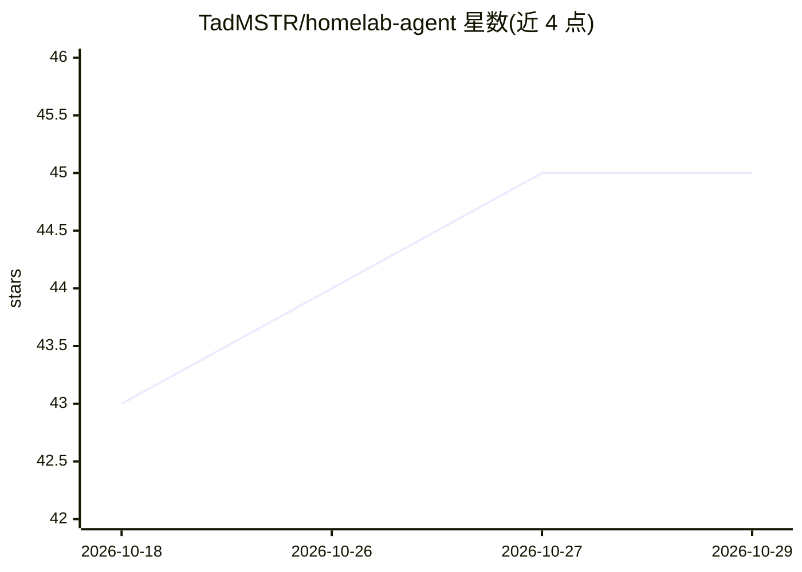

# TadMSTR/homelab-agent

⭐ 45 · Shell · MIT · 推送 2026-10-28 · [GitHub](https://github.com/TadMSTR/homelab-agent) · 个人维护

**自托管多 Agent 平台参考构建：单机运行五个 AI Agent**

面向自托管（homelab）用户的 AI 平台参考构建文档仓库：在一台 Debian 服务器上以 60+ Docker 容器为底座，运行 sysadmin、developer、researcher、writer、security 五个 Claude Code 常驻 Agent，通过任务队列与 Matrix 协作。机制包括 manifest 控制的 scoped-mcp 工具代理（凭据由 Vault 注入）、三层持久记忆（qmd 语义检索 + OpenSearch 全文）、JSONL 事件台账。仓库提供 76 份组件文档与 compose 栈；前置条件为 32GB+ 内存（96GB 推荐）、NVIDIA GPU 或远程 Ollama、Claude 订阅与 Anthropic API key。

## 筛选速览

| 维度 | 判定 | 备注 |
|---|---|---|
| AI 角色 | `ai-ecosystem` | LLM/agent 周边工具 |
| 许可风险 | `permissive` | MIT |
| 部署形态 | `None` |  |
| 模型依赖 | local-ok | 支持本地模型 |
| 硬件要求 | — | 无带数字的原话,不猜 |
| 安装摩擦 | `low` | 无编译、无系统依赖或容器化 |
| 成熟度 | — | 结构信号不足 |

## 能力要点

- 5 个常驻 Claude Code Agent 经 Matrix 与任务队列协作
- scoped-mcp 按 manifest 代理工具，凭据不暴露给 Agent
- 三层持久记忆：qmd 语义检索 + OpenSearch 全文 + 元数据查询
- 76 份组件运维文档与 22 个 compose 栈（.env.example 可复制）

## 适用场景

- 参照该仓库搭建自己的自托管多 Agent 平台
- 查阅各服务组件的配置、端口与健康检查运维手册
- 了解多 Agent 工具权限隔离与跨 Agent 事件审计的实现方式

## 场景标签

`多智能体` · 领域:Agent 开发

## 证据(README 行号)

> L9: A platform for running a team of AI agents on a single server. Five agents — sysadmin, developer, researcher, writer
> L35: │  Layer 3: Multi-Agent Claude Code Engine                       │
> L68: This is the part that ties everything together. Five resident agents run as scoped Claude Code projects, each with 

## 星数曲线

2026-10-18 43 → 2026-10-29 45（+2）

---
*卡片 v1 · prompt 1.4 · 生成 2026-10-25 · 置信度 high · 依据 README sha `8c51f520aaf5` · [字段定义](../../DATASET.md)*
