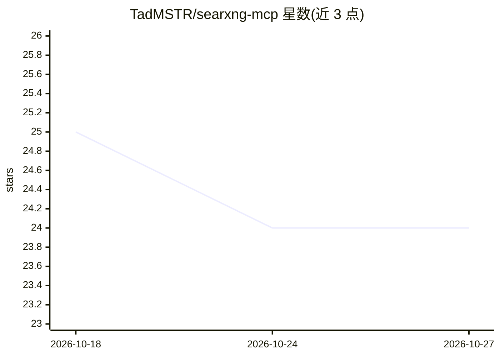

# TadMSTR/searxng-mcp

⭐ 24 · TypeScript · MIT · 推送 2026-10-26 · [GitHub](https://github.com/TadMSTR/searxng-mcp) · [官网](https://www.npmjs.com/package/@tadmstr/searxng-mcp) · 个人维护

**基于自托管 SearXNG 的私有网络搜索 MCP 服务器**

为 Claude Code、LibreChat 等 MCP 客户端提供私有网络搜索能力的 TypeScript MCP 服务器。以自托管 SearXNG 为唯一必需组件，其余能力按需叠加：本地 ML cross-encoder 重排序、多级抓取级联（Firecrawl/Crawl4AI/进程内原生抓取+Wayback 回退）、Ollama 查询扩展与带引用的摘要合成、按域学习能力、Valkey 持久缓存、OpenTelemetry 观测。提供 npx 运行与 GHCR 容器镜像，examples/ 下四档 compose 配置（2-12 容器，约 600MB-24GB 内存），全部能力不依赖云端 API。

## 筛选速览

| 维度 | 判定 | 备注 |
|---|---|---|
| AI 角色 | `ai-ecosystem` | LLM/agent 周边工具 |
| 许可风险 | `permissive` | MIT |
| 部署形态 | `self-host` | docker 或自建部署 |
| 模型依赖 | local-ok | 支持本地模型 |
| 硬件要求 | `cpu-ok` | |
| 安装摩擦 | `low` | 无编译、无系统依赖或容器化 |
| 成熟度 | — | 结构信号不足 |

## 能力要点

- SearXNG 为唯一必需依赖，其余组件可选并优雅降级
- 本地 ML cross-encoder 重排序（CPU-only、无需 API key）
- 多级抓取级联与按域能力数据库路由
- Ollama 生成带来源引用的摘要，无云端 API

## 适用场景

- 给 Claude Code 或 LibreChat agent 接入不经过第三方搜索 API 的网络搜索
- 自托管栈内实现搜索-抓取-摘要一体的研究工作流
- 通过 compose 阶梯逐步从最小部署扩展到全功能部署

## 场景标签

`网页抓取` · 领域:效率与自动化

## 证据(README 行号)

> L8: An MCP server for private web search via a self-hosted SearXNG instance. SearXNG is the only requirement; everything
> L10: Designed for use with Claude Code and LibreChat agents that need web search without sending queries to a third-part
> L24:   npx @tadmstr/searxng-mcp

## 星数曲线

2026-10-18 25 → 2026-10-27 24（-1）

---
*卡片 v1 · prompt 1.4 · 生成 2026-10-27 · 置信度 high · 依据 README sha `379355d740c3` · [字段定义](../../DATASET.md)*
