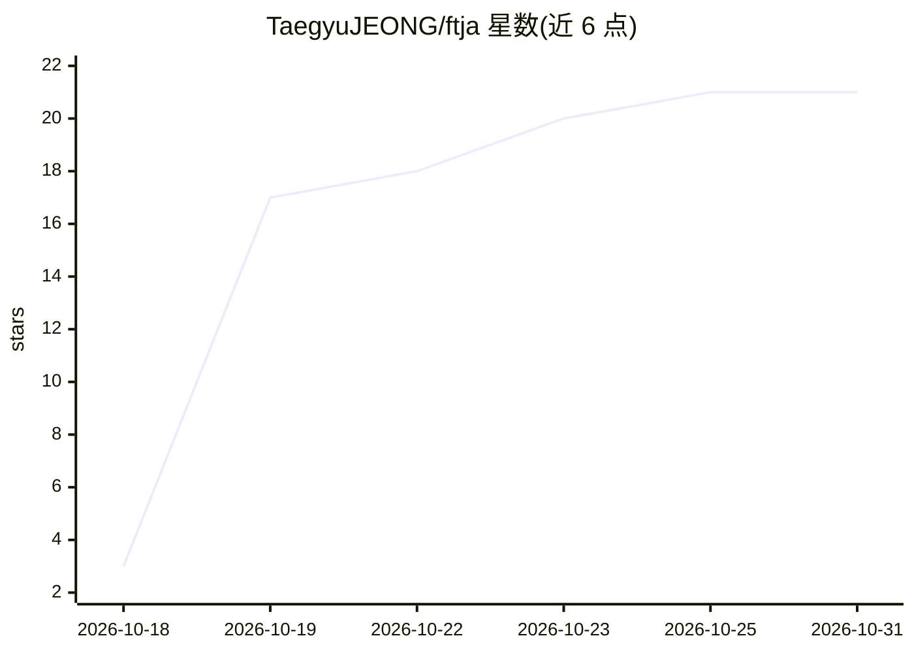

# TaegyuJEONG/ftja

⭐ 21 · Python · MIT · 推送 2026-10-30 · [GitHub](https://github.com/TaegyuJEONG/ftja) · [官网](https://ftja.vercel.app) · 个人维护

**运行在 Claude Code 内的求职筛选 agent：读 LinkedIn 公开职位并给出理由**

FTJA 是一套部署在用户本地 Claude Code 会话中的求职筛选技能：先用规则代码按关键词/语言过滤 LinkedIn 公开职位（无需登录），再由用户自己的 agent 依据其简历与自定 rubric 逐条评估剩余职位，并为每个判定引用职位描述原文。数据均为本地文件，无独立服务器；需 macOS 或 Windows 上的 Claude Code，Linux 未支持；一次大跑可能消耗约 1200 万 token 并触及会话限额。

## 筛选速览

| 维度 | 判定 | 备注 |
|---|---|---|
| AI 角色 | `ai-native` | 本体是模型或模型工具 |
| 许可风险 | `permissive` | MIT |
| 部署形态 | `library` | 以包/库形式分发 |
| 模型依赖 | locked-api |  |
| 硬件要求 | — | 无带数字的原话,不猜 |
| 安装摩擦 | `low` | 无编译、无系统依赖或容器化 |
| 成熟度 | `idea` | |

## 能力要点

- 规则预过滤（无 AI）+ rubric 判定的两段式流水线，判定逐条引用职位描述并经代码校验
- 本地优先：简历、rubric、运行历史均为本机文件，无 FTJA 服务器
- 8 个技能命令（setup/run/remote/tune/review 等），可按阶段开关流水线
- macOS 支持 LaunchAgent 定时运行

## 适用场景

- 批量筛选招聘信息，只看符合自己标准的职位
- 追踪每次求职决策的理由并据此迭代筛选标准
- 核查职位的真实远程程度（Remote check）

## 场景标签

 · 领域:求职/职业工具

## 证据(README 行号)

> L3: **Stop reading every job description yourself.** FTJA is a job-search agent
> L24: 3. **Judges the rest against your rubric.** Your agent reads each remaining
> L34: You need a Mac or a Windows PC and Claude Code.

## 星数曲线

2026-10-18 3 → 2026-10-31 21（+18）

---
*卡片 v1 · prompt 1.4 · 生成 2026-10-28 · 置信度 mid · 依据 README sha `5e05b9a77b14` · [字段定义](../../DATASET.md)*
