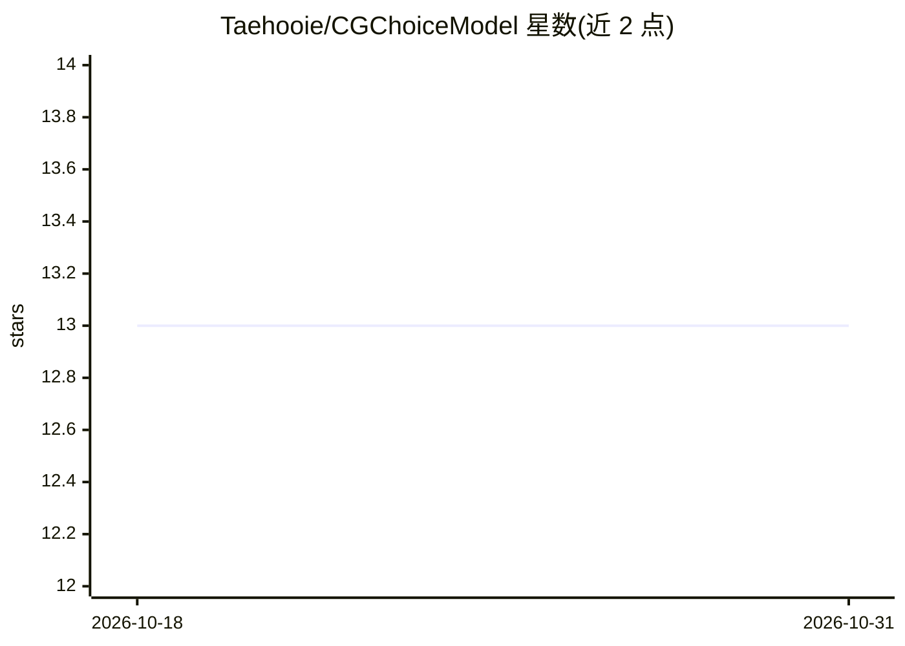

# Taehooie/CGChoiceModel

⭐ 13 · Python · 推送 2026-03-17 · [GitHub](https://github.com/Taehooie/CGChoiceModel) · 个人维护

**基于计算图与自动微分的离散选择模型实现框架**

开源库，实现离散选择模型的自动微分，并以 TensorFlow 2.0 表示面向图的函数。定位为将计量经济模型与机器学习算法整合的计算图框架，服务于交通等领域的数据驱动建模研究者。配套发表期刊论文（Transportmetrica A, 2021）。README 仅含项目定位与论文链接，未给出安装命令、依赖或使用示例，实际使用需查阅代码库。

## 筛选速览

| 维度 | 判定 | 备注 |
|---|---|---|
| AI 角色 | `ai-ecosystem` | LLM/agent 周边工具 |
| 许可风险 | `none` | — |
| 部署形态 | `None` |  |
| 模型依赖 | — | README 未给出锁定关系 |
| 硬件要求 | — | 无带数字的原话,不猜 |
| 安装摩擦 | `low` | 无编译、无系统依赖或容器化 |
| 成熟度 | — | 结构信号不足 |

## 能力要点

- 离散选择模型的自动微分实现
- 使用 TensorFlow 2.0 表示面向图的函数
- 配套发表于 Transportmetrica A 的期刊论文

## 适用场景

- 研究者构建可自动微分的离散选择模型
- 在计算图框架下整合计量经济模型与机器学习算法
- 交通行为建模研究中的模型估计

## 场景标签

 · 领域:计量经济/交通建模

## 证据(README 行号)

> L3: This open-source aims to implement automatic differentiation for discrete choice models and represent the graph-orie
> L5: Published journal paper: Kim, T., Zhou, X. and Pendyala, R.M., 2021. Computational Graph-based Framework for Integra

## 星数曲线

2026-10-18 13 → 2026-10-31 13（+0）

---
*卡片 v1 · prompt 1.4 · 生成 2026-10-31 · 置信度 mid · 依据 README sha `cfd48e89d093` · [字段定义](../../DATASET.md)*
